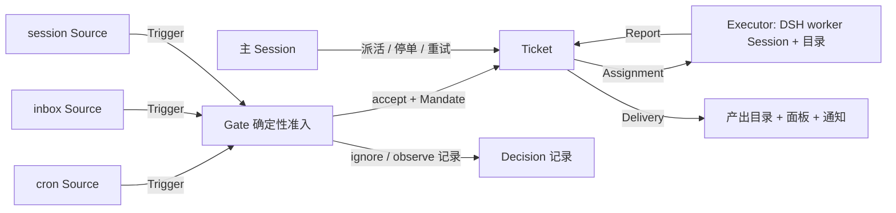

# myagent — 设计文档

> 参照 [dsh-superagent-prototype](https://github.com/deepseek-ai/dsh-superagent-prototype) 的领域模型，为个人使用重新设计并大幅简化的主动式智能体系统。运行在 DeepSeek Harness (DSH) 之上，以 bundle 形式安装。

## 0. 一句话

**定时和本地投递的任务成为 Trigger，确定性 gate 把它们变成有授权的 Ticket，每个 Ticket 在自己的 DSH Session 和目录里执行，结果落到文件系统并在面板上可见。**

继承 superagent 的核心原则：**尽量少占用人的注意力，尽量多交付价值。** 只在被规则允许时行动；只在有事需要人决定或有结果可用时才发声。

## 1. 与 superagent 的关系：保留了什么，砍掉了什么

| superagent 概念 | myagent v1 | 取舍理由 |
| --- | --- | --- |
| Source（来源，可插拔 kind） | **保留**：`cron` + `inbox` + `session` 三个 kind | 这是扩展点，聊天平台二期就靠它接入 |
| Trigger（不可变事件，幂等 id） | **保留** | 审计与幂等的最小单位，重启不能重放事件 |
| Thread / Subscription / Correlation | **砍掉** | v1 每个 Trigger 最多产生一个 Ticket，没有"后续对话自动到达工单"的需求；操作者通过主 Session 追加。留 `origin.triggerId` 作为接缝 |
| Eval（gate + 模型研判两层） | **只保留 gate（确定性）** | cron 和 inbox 的任务都是操作者自己写下的，天然是 `explicit` 强度，无需模型判断"这是不是在请求工作"。`Decision` 记录保留，`Assessor` 端口留空接缝 |
| Mandate（授权：策略版本/范围/强度/发起人） | **保留** | "为什么可以干这件事"必须可追溯；策略变更要能影响在跑的工单 |
| Ticket / Assignment / Report | **保留** | 工单定义自己的状态，不跟随 Session；派工与工单分离，才能重试和接管 |
| Policy（版本化规则 + 每个 Source 的准入部分） | **保留，简化**：`acceptMode` + 每个 Source 的 `enabled` + 允许的发起人 | 版本哈希保留，`policyVersion` 记在每个 Mandate 上 |
| Executor（每 Ticket 一个 Session + 目录） | **保留** | 隔离是安全边界，也是可审查性来源 |
| Channel（写回来源的地址） | **简化为 Delivery**：文件系统产出 + 面板 + 可选本地通知 | v1 没有聊天，写回地址只有一个；端口保留，Telegram/飞书二期实现同一个接口 |
| Effects（持久化副作用队列 + 退避重试） | **保留** | 启动 worker、投递输入、发通知都必须能跨重启恢复 |
| Store（SQLite，单一写者） | **保留**，用 `node:sqlite` | 零原生依赖；每类状态只有一个写者 |
| 主 Session（orchestrator） | **保留** | 操作者在 DSH GUI 里直接对它说话派活、查状态、停单 |
| Web 面板（React client plugin） | **简化为服务端渲染的单页 HTML** | 免掉 client bundle / ModuleLoader 那一整套构建；v1 面板只需要看状态和改设置 |
| 提示词版本管理 + 团队可覆盖段落 | **保留（无版本历史）** | 提示词是行为的主要调节手段，必须能在面板里改；v1 只存当前版本 + 内置默认对照 |

**净结果**：概念从 15 个降到 9 个（Source / Trigger / Policy / Decision / Mandate / Ticket / Assignment / Report / Delivery），代码量约为 superagent 的 1/5，但保留了它最有价值的三条脊骨：**幂等的 Trigger、可追溯的 Mandate、每工单一个隔离执行环境**。

## 2. 领域流

一条 Trigger 的完整旅程：

1. **产生**：cron 到点、inbox 目录出现 `.md` 文件、或操作者在主 Session 里说"帮我调研 X"（主 Session 调 `myagent_create_ticket` 工具）。
2. **入库**：`Engine.receive(trigger)` 在**一个事务**里写入 Trigger（按 id 幂等，重复到达返回 `duplicate`），并跑 gate。
3. **准入**：gate 是纯函数——Source 启用吗？发起人在允许名单里吗？`acceptMode` 是 `auto` 还是 `observe`？产出 `Decision`：`accept` / `ignore` / `observed`（observe 模式下记录"本来会接"但不执行）。
4. **授权**：accept 时原子地创建 `Mandate`（含 `policyVersion`）+ `Ticket` + 第一个 `Assignment`，并 enqueue `launch` effect。
5. **执行**：`launch` effect 跑 prepare 命令建目录 → 创建/复用 worker Session（`myagent-worker` 预设）→ 投递任务消息。worker 干活，通过 `myagent_report` 工具报告 `progress` / `ready` / `blocked` / `failed`。
6. **交付**：`ready` 报告触发 Delivery——把产出登记到 `<workRoot>/<ticket>/`，写 `RESULT.md`，面板上标记完成，可选发本地通知。
7. **结束**：Ticket 进入 ended，worker Session 的工具被 guard 锁住（"工单已结束，新工作需要新的授权工单"）。

## 3. 三个 Source

### cron
- 设置里一组 schedule：`{ id, name, timing, prompt, enabled }`，timing 支持 `every_seconds` / `daily` / `weekly` / `cron`（五段 Vixie 表达式，时区默认 `Asia/Shanghai`）。
- 自己算 next run 并持久化在 SQLite（不用 DSH 的 `schedule` 服务，因为它绑定 SessionId 且以"给某个 Session 投递提示词"为语义；myagent 需要的是"产生 Trigger 走 gate"，并且要在自己的面板里管理）。
- 重启后从存储的 next run 恢复；错过的执行**只补一次**（记录 `missed` 数量在 Trigger meta 里），避免重启风暴。
- 幂等：Trigger id = `hash(cron:<scheduleId>:<scheduledAt>)`，所以同一次计划到点只会产生一个工单，即使进程重启时重复触发。

### inbox（本地目录投递）
- 轮询 `<inboxDir>`（默认 `<stateDir>/inbox`，可在插件 config 或设置里改到任何目录），每 5 秒一次；只认 `*.md`。
- 文件内容就是任务描述；文件名（去扩展名）成为工单标题。支持极简 front matter：`title:`、`scope:`、`priority:`。
- 接手后把文件移到 `<inboxDir>/accepted/<ISO 时间戳>-<原名>`（`inbox.ts:74-76`，时间戳里的 `:` 和 `.` 换成 `-`）；gate 拒绝的移到 `rejected/`，只观察不执行的移到 `observed/`，都在文件头追加一行 `<!-- myagent: 原因 -->`。
- 幂等：Trigger id = `hash(inbox:<路径>:<mtimeMs>:<size>)`，同一个文件被重复扫描不会产生第二个工单。

### session（对话派活）
- 操作者在 DSH GUI 里对主 Session 说话。主 Session 有 `myagent_create_ticket` / `myagent_list_tickets` / `myagent_ticket_status` / `myagent_answer_ticket` / `myagent_note_ticket` / `myagent_stop_ticket` / `myagent_retry_ticket` 七个工具。
- 主 Session **按需创建**（面板按钮或 `POST /api/main-session`），不在插件挂载期创建：挂载期诞生的 agent 会在宿主启动失败时跟着被拆解，把插件的错误塞进宿主自己的关闭链路。
- 这条路的 Trigger 由主 Session 显式创建，`actor` 是 `operator`，强度 `explicit`。
- 主 Session 不是"另一个模型在研判"，它就是操作者的代理界面——这符合"少概念"：不需要为"人直接说话"再造一个来源类型。

## 4. 执行环境

- 每个 Ticket 一个目录：`<workRoot>/<slug>-<ticketId 前 8 位>/`（`executor.ts:75`），默认 workRoot = `<stateDir>/work`，即 `~/.dsh/state/myagent/work`。
- prepare 命令可配置（默认空 = 只建目录）；跑 prepare 时注入环境变量 `MYAGENT_TICKET_ID`、`MYAGENT_TICKET_TITLE`、`MYAGENT_DIRECTORY`、`MYAGENT_POLICY_VERSION`、`MYAGENT_VIA`、`MYAGENT_SENDER`（`executor.ts:234-239`）。
- worker Session 用 `myagent-worker` 预设：文件读写、搜索、shell（前台 5 秒转后台）、后台任务、web 搜索、技能、todo、子智能体。**没有**：向人提问、present、plan mode、插件管理、调度、goal、workflow——这些在无人值守的 worker 里没有意义或有害。
- worker 的权限是 `danger-full-access`（无人值守必须能干活），但**目录隔离**+**工单结束即锁工具**是边界；`acceptMode: observe` 是起步时的安全挡位。
- 并发上限 `maxWorkers`（默认 2），由 WorkerSlots 管理；超出的 launch 以 `Later` 退回队列，不算失败。

## 5. 状态与恢复

- 单一 SQLite：`<stateDir>/myagent.sqlite3`（默认 `~/.dsh/state/myagent`）。启动前用 pid 文件锁住 stateDir，防止第二个进程迁移/写同一个库。
- 每类状态只有一个写者：Trigger/Ticket/Decision/Assignment → Engine；Source 的读取位置 → 该 Source；设置与提示词 → Settings/Prompts；effect 行 → Effects。
- Effects 队列持久化，指数退避重试；`Later` 表示"稍后再试"且不计失败次数（没有空闲 worker 槽时用）。
- 重启恢复：Assignment 说在跑、而它的 Session 不在，就是被进程死亡打断——标记为 interrupted、附一条恢复说明、开一个新 Assignment 在同一目录里接着做；已载入的 Session 不动。
- pending 的 launch 靠持久化 effect 队列自己重放，不需要额外扫描；重试预算（5 次退避）耗尽后 effect 被丢弃，此时 Ticket 停在 pending，由操作者用 `retry` 推一次——`canRetry` 认「pending / 投递失败 / 汇报 waiting / 在等人」四种停滞，不认「正在干活」。
- 因 `failed`/`blocked` 等待人的工单保持等待，不自动重试。
- 瞬时错误（网络/限流/5xx）重试 3 次，15s→30s→60s；prepare 命令失败**不**自动重试（残留目录会被误认为已准备好），直接把工单标为 failed 等人处理。

## 6. 面板与管理 API

面板是**监工台**，不是下任务的入口。下任务（尤其带文件、图片、文档）走主 Session：DSH 的 GUI 已经是一个成熟的对话入口，原生支持附件与流式进度，在面板里重造一套只会更差。面板负责的是：看得见谁在跑、跑到哪一步、产出了什么、谁在等人、以及停下来。

API 全部同源（`x-myagent-request: 1` 标记头 + loopback + 端口校验），JSON 出入：

| 路由 | 用途 |
| --- | --- |
| `GET state` | 一次拿齐头部所需：机器路径、主 Session、设置、健康板、计数、三个来源的状态 |
| `GET tickets` / `GET tickets/:id` | 列表与详情（含 mandate、scope、attachments、assignments、reports、inputs、result） |
| `GET tickets/:id/progress` | **worker 此刻在干什么**：Session id、第几轮、最近 8 个工具调用、最后说的一句话 |
| `GET tickets/:id/files` / `GET tickets/:id/file?path=` | 产出目录的列表与单文件内容（文本内联，二进制给 base64 供下载）；`../` 一律拒绝 |
| `POST tickets` / `answer` / `note` / `stop` / `retry` | 派活与四种干预，全部经过同一道门禁与同一套 Engine 规则 |
| `GET schedules` / `POST schedules/preview` | 排期列表（下次触发按宿主时区现算）与"这么写会在什么时候跑"的预览 |
| `GET recipes` | 出厂配方，供面板做模板；与 `examples/` 是同一份字节 |
| `GET decisions` / `GET triggers` / `GET effects` | 门禁判定、原始 Trigger、持久副作用队列的积压 |
| `PUT settings` / `GET|PUT prompts` | 整份设置（严格 schema，未知字段报错并点名）与两个提示词的覆盖 |
| `POST pass` | **现在就看一眼**：让每个 Source 立刻轮询一次，再跑一轮该跑的 |
| `POST main-session` | 按需创建/恢复主 Session，返回 DSH 真正给的 id |

- `/myagent/`：单页 HTML（服务端静态文件，无构建步骤），轮询 `/myagent/api/state`。
- 面板首屏只显示**需要人的东西**：等待决定的工单、失败的投递、Source 健康问题。健康状态不占空间。
- API 路由：以 `http.ts` 的路由表为唯一事实来源（清单见本文 §6 与 README「面板管什么」）。暂停不是单独的路由，而是 `PUT settings` 改 `paused`。
- 同源限制：只接受 `127.0.0.1:<port>` 且带 `x-myagent-request: 1` 的请求；webServer host 不是 loopback 时拒绝注册。

## 7. 二期接缝（已预留，未实现）

- **聊天 Source**（Telegram/飞书）：实现 `SourceKind` 接口 + `Channel.send`，即可把 Delivery 从"文件系统"扩展到"回到原对话"。届时需要引入 Thread + Subscription（superagent 的完整模型），Trigger 的幂等 id 设计已经支持。
- **模型研判层**：`Assessor` 端口已在 Engine 里留位；接入后 `acceptMode: auto` 才允许 `inferred` 强度的主动接单。
- **React 面板**：API 已经是稳定的 JSON 契约，换前端不需要改后端。

## 8. 文件地图

| 路径 | 职责 |
| --- | --- |
| `src/index.ts` | 插件入口：读 Config，挂载 Runtime。`apply()` 永不 reject——插件起不来就只是插件起不来 |
| `src/deployment.ts` | 插件 Config schema（schemastery）与 Machine 事实 |
| `src/core/model.ts` | 领域类型：Trigger / Ticket / Mandate / Assignment / Report / Decision |
| `src/core/ids.ts` | 由输入派生的确定性 id |
| `src/core/policy.ts` | gate、策略版本、设置 schema |
| `src/core/engine.ts` | 唯一的领域写者，所有命令在一个事务里改聚合 |
| `src/app/store.ts` | `node:sqlite` 存储与仓储 |
| `src/app/effects.ts` | 持久化副作用队列（退避重试、`Later`） |
| `src/app/passes.ts` | 一次一个 pass 的调度器 |
| `src/app/delivery.ts` | 按 requestId 幂等投递消息给 DSH Agent |
| `src/app/sessions.ts` | 创建/恢复/装饰主 Session 与 worker Session：提示词段落、工具白名单、权限预设、幂等投递。恢复路径与新建路径配置完全一致 |
| `src/app/tools.ts` | 两个角色的工具定义 |
| `src/app/prompts.ts` | 内置提示词与团队覆盖、合成 |
| `src/app/http.ts` | 管理 API 与面板页面 |
| `src/app/runtime.ts` | 组合根：构造、启动、停止 |
| `src/sources/*.ts` | SourceKind 协议与 cron / inbox / session 三个实现 |
| `src/executor/dsh.ts` | 每 Ticket 一个 worker Session 与目录 |
| `panel/index.html` | 面板单页 |
| `prompts/*.md` | 内置提示词 |
| `tests/*.spec.ts` | 领域规则、cron 计算、inbox 接手、gate 的单测 |
