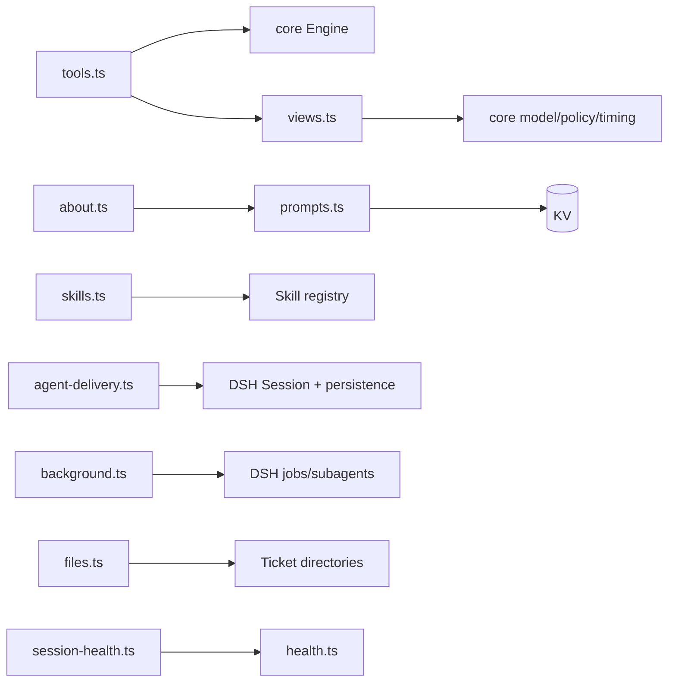

# Audit38 · App 辅助模块逐文件审核

范围：about.ts、agent-delivery.ts、background.ts、files.ts、health.ts、session-health.ts、prompts.ts、skills.ts、views.ts、tools.ts。只读静态审核；不修改源码、测试、运行态，不构建/安装/推送。主线负责实验复现。

## 操作日志

- S001 计划：全文读取上述十个辅助模块，梳理拓扑、导出函数、状态/IO 边界与失败路径；核实关联测试关键断言。先创建本标题报告，再增量记录。未执行进程命令。

## 覆盖状态

静态审核完成：10/10 指定生产文件全文读取；关联测试 8 个文件全文读取（agent-delivery、background、files、session-health、prompts、skills、views、tools）。未读取/未宣称 about 专项测试（未发现），health 无专项测试。未运行实验、测试、构建或安装。

## 静态拓扑

## 逐文件记录

### src/app/about.ts
`changesView()` 同步读取 `packageFile('CHANGELOG.md')`，正则解析 semver/全角日期/文本行（12-37）；输入包内 Markdown，输出 ChangeEntry[]，无持久化。失败路径捕获任意读/定位异常并返回空 changes。静态确认：注释称“页面会说明缺失”，但 catch 返回 `{changes:[]}`，与“空历史”不可区分，打包缺 CHANGELOG 时面板静默为空。测试：未发现 about 专项；prompts.spec 仅间接验证 packageFile。

### src/app/agent-delivery.ts
`messageId(requestId)` 生成 `myagent:` 稳定消息 ID；session/event 监听把已到达历史加入 WeakMap；`history()` flush 后分页读取持久日志；`holds()` 检查历史及 nextTurn/nextStep；`send()` 在 abort/target disposed 检查后 queue 或 inject，flush 成功才 accepted（20-115）。边界是 DSH Session/inbox/persistence；无 Store 持久化，自身依赖 DSH 日志。失败：历史读取失败清除 loaded 并抛错，避免把未知当空。测试 agent-delivery.spec 全文覆盖分页、重启、入箱幂等、abort/dispose。静态候选：queue 分支不立即 `seen.ids.add(id)`（102-109），依赖 session/event 事件异步回填；若 followup 已入 inbox 但事件丢失且同实例立即重入，第二次检查 inbox 通常阻止重复，仍需真实 DSH 事件顺序实验。

### src/app/background.ts
`until` 以 abort/超时竞争 work（47-55）；`killJobs` 只杀 owner 且 running/stopping 作业，先 wait 后 kill，失败重查仍存活才聚合抛错（57-80）；`stopSubagents` 兼容缺服务、重查已自行结束子代理、finally cancel agent/等待 idle（93-113）；`stopBackground` 汇总 jobs/subagents 双失败（115-124）。副作用完全经 DSH jobs/subagents。测试 background.spec 全文覆盖超时、归属、竞态、聚合错误。边界：until 超时不取消底层 Promise，调用者必须保证 DSH kill/drain 已发出；这是设计约束，非独立缺陷。

### src/app/files.ts
路径安全与目录浏览：`resolveInside` 词法边界；`resolveRealInside` realpath+lstat 拒绝符号链接；`listFiles` 深度 6、条目 500、跳过依赖目录、忽略 symlink；`readForPanel` lstat 后读取并 base64（9-142）。输入 Ticket root/requested/absolute，输出 FileListing/bytes；IO 失败列表按空处理。测试 files.spec 全文覆盖遍历、截断、symlink、HTTP 路径。静态确认：`MAX_FILE_BYTES` 只用于 `isTextFile`，`readForPanel` 本身不限制读取大小（137-141）；若任何 HTTP caller 直接传入已解析路径，可读取任意超大文件并造成内存峰值。需检查主线调用者/实验确认是否已有 route 层上限。

### src/app/health.ts
`HealthEntry` 单槽 record/problem/snapshot；`HealthBoard` 按 name 建 entry、problems 过滤非 ok、snapshot 输出全表（14-41）。纯内存、时间取 `new Date()`，调用者负责每次观察清除/保留。无专项测试全文读取；由多模块测试间接验证。静态缺口：同一 HealthEntry 多异步 writer 互相覆盖是接口语义，模块无版本/来源校验；错误若被另一个 writer record 会消失，需依赖调用方 SessionHealth/Effects 记账。

### src/app/session-health.ts
按 subject key 记 Session 问题；`problem` 更新、`clear` 删除、`summarize` 仅空账时写 quiet；多问题合并文本（22-127）。与 HealthEntry 组合，解决 Ticket/主会话/伪装 Session 互相覆盖；重启内存问题不会恢复，运行时须重新观测。测试 session-health.spec 全文覆盖伪装、主会话恢复、并发主体、dispose 清理、正常 turn 清除。

### src/app/prompts.ts
包内 prompt 路径探测/缓存，KV config/revision/current/version；PromptConfig 同时保存 overrides 与 SavedSkill。`save`/`saveSkill`/`setSkillEnabled`/`removeSkill`/`recordSkillUse` 写 KV 并通知 listeners（103-277）；技能名校验、内建冲突、长度/空值门禁。测试 prompts.spec 全文覆盖角色、revision、技能生命周期与保留名。静态确认：save/saveSkill/setSkillEnabled/removeSkill 先 `store.set(KV.promptsConfig, …)` 再 `store.set(KV.promptsRevision, …)`，本模块未包在 Transaction（197-199,209-211,224-226,263-266）；进程崩溃/第二写失败可留下 config 已更新而 revision 未变，Sessions 可能不触发重绑定。调用方是否已包事务需主线核查；recordSkillUse（239-245）仅写使用计数，按设计不 bump revision。需主线故障注入验证。

### src/app/skills.ts
定义三个内建虚拟技能及标签；`registerSkills` 全局注册、报告失败、逆序幂等 disposer；`registerDynamicSkills` 以 agent-scoped port 注册 enabled crafts，onChange 重同步，禁止 userInvocable；`confirmRegistered` 回读 catalog 报缺失（33-510）。依赖 DSH skill registry；持久化由 Prompts 提供。测试 skills.spec 全文覆盖注册内容/作用域/注入隔离/失败/重同步。静态候选：`registerDynamicSkills.sync` 先释放全部旧项，再逐个注册；若注册中途 listener/host 异常，旧能力已撤回且新集合可能半注册，调用方仅收到 report，需运行态确认。

### src/app/views.ts
纯投影：`updatedAt` 汇总 Ticket 所有时间并排序；`ticketSummary` stage/waits/mandate/work/triage；`ticketView` 详情与脱敏后的 Inputs；`scheduleView` next run/zone/budget/preset/reply 文案；`decisionView` gate reason 文案（7-152）。无 IO/持久化。测试 views.spec 全文覆盖状态、授权、输入交付、调度文案、triage。静态缺口：`updatedAt` 依赖所有时间是可比较 ISO 字符串；损坏/非 ISO 持久记录会产生不可靠排序，模型无运行时 schema 防护。

### src/app/tools.ts
`definitionOf` 将 Zod schema→JSON Schema/renderer/parse wrapper；`workerTools` 提供 report/read_artifact/ask_desk/handback/raise_decision/note；`mainTools` 提供创建、列表、recall、状态、answer/reply/decision/note/stop/close/retry（25-560）。工具均经 Engine/ToolsHost，拒绝统一为 code/error/next；报告先于技能 promotion。测试 tools.spec 全文覆盖注册 schema、权限/状态、幂等、回忆、报告与 promotion 顺序。静态确认：`myagent_report` schema 的 `question` 标为 optional（177），但 description 写“blocked 必须”；执行传递 undefined，Engine 会把 blocked/failed/waiting 的 attention 回退到 summary（core/engine.ts:1148-1157），因此模型可发无 question 的 blocked，破坏“必须一个具体问题”的工具契约。建议 schema 用条件 refine 或在 execute 前拒绝。另 `myagent_close_ticket` 未传 assignmentId 给 Engine.report（539），若 triage Session 的报告上下文存在并发/过期 attempt，依赖当前 runningAssignment，需主线验证。

## 可确认问题与待验证

1. **Prompt 更新非事务（静态确认，P1）**：prompts.ts:197-199、209-211、224-226、244-245、263-266；config/revision 分两次 KV 写，模块自身未包 transaction，崩溃/第二次失败可能造成内容与 revision 分裂，Sessions 可能不重绑或读到半状态。调用方是否以Store事务包裹、以及故障可达性待主线复现；不把模块静态风险误称为已复现。
2. **工具契约允许无问题的 blocked（静态确认，P2）**：tools.ts:174-178；schema 未强制 blocked→question，Engine 以 summary 兜底。影响前台无法得到可行动问题；无需实验即可复现于静态调用路径。
3. **about 缺 CHANGELOG 静默空页（静态确认，P2）**：about.ts:23-31；包装错误与真实空历史相同，影响发布可见性。
4. **文件读取大小未在模块边界限制（静态设计风险，P2，待验证）**：files.ts:137-141；`readForPanel` 不检查 MAX_FILE_BYTES，需核查主线 route 是否先 lstat/限制。
5. **Dynamic skill 重同步半完成风险（待验证，P3）**：skills.ts:440-466；注册异常/回调重入时旧集合已撤销，新集合可能部分存在。

## 测试映射与覆盖边界

|模块|关联测试|状态|
|---|---|---|
|about.ts|未发现 about 专项；prompts 间接|未完整覆盖|
|agent-delivery.ts|tests/agent-delivery.spec.ts|全文已读|
|background.ts|tests/background.spec.ts|全文已读|
|files.ts|tests/files.spec.ts|全文已读|
|health.ts|无 health 专项；session-health/background 等间接|未完整覆盖|
|session-health.ts|tests/session-health.spec.ts|全文已读|
|prompts.ts|tests/prompts.spec.ts|全文已读|
|skills.ts|tests/skills.spec.ts|全文已读|
|views.ts|tests/views.spec.ts|全文已读|
|tools.ts|tests/tools.spec.ts|全文已读|

## 操作日志（追加）

- S002：全文读取 10 个辅助生产文件；每个文件输出完整内容。未执行测试/构建/安装/实验，退出码：无进程执行。
- S003：全文读取 8 个关联测试文件；未发现 about/health 同名专项，未以 grep 命中代替覆盖。未修改生产代码、测试、运行态。
- S004：本报告增量写入完成；主线负责所有候选实验与复现。

## 结论

指定辅助 app 10/10 已全文静态审查；4 项静态确认/设计风险已给出文件行号和触发条件，2 项待验证候选明确交主线。报告不等同全项目通过。
