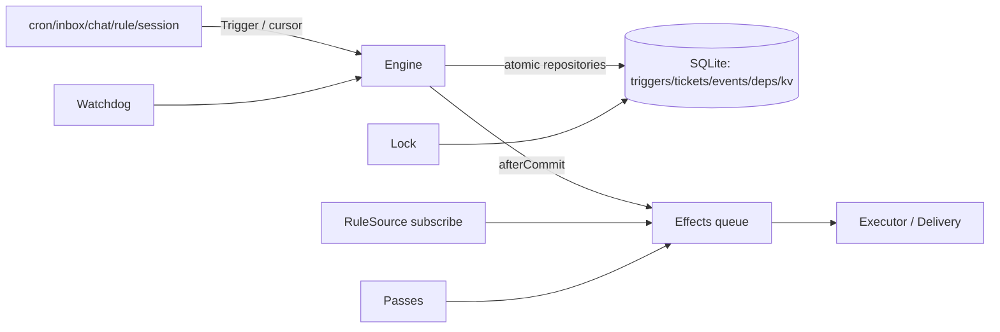

# Audit38 · Core / Sources / App persistence 逐文件审核

范围：src/core/*.ts、src/sources/*.ts、src/app/store.ts、effects.ts、passes.ts、lock.ts、watchdog.ts，及关键断言关联测试。方法：全文静态阅读、调用与状态转换核实；不构建、不安装、不运行测试或实验、不修改生产代码/测试/运行态。所有发现均区分静态确认与待验证。

## 操作日志

- C001 计划：先读 docs/v2/38-topology-audit.md，枚举目标源文件与测试；结果：已全文读取纪律文件（34 行）；目标源文件 20 个。首次读取误用了父目录路径，工具返回 not found；首次 limit=4000 超出工具上限，未读取。测试初次 glob 范围过宽包含 node_modules，将收窄。以上为工具读取，无进程退出码。
- C002 计划：全文读取全部目标源文件，分批增量记录职责、拓扑、状态及证据；收窄查找仓库测试。只写本报告。

## 审核状态

静态审核已完成（目标生产文件 20/20 全文读取）；关键关联测试仅读取 transaction、recovery、watchdog、effects、sources、engine，未读取其余测试，未运行测试/构建/实验。不得将范围视为全项目通过。

## 拓扑总览

关键边：Source 的游标经 `SourceHost.cursor` 持久化到 `kv`（src/app/store.ts:103-106, 110-124）；Engine.receive 在 tx.atomic 内写 Trigger/Decision/Ticket/Event，启动经 afterCommit（src/core/engine.ts:297-409）；DomainEvent 经构造器统一 afterCommit（src/core/engine.ts:272-285）；rule 监听 `ticket.ended` 后将 Trigger 入效果队列（src/sources/rule.ts:35-100）；效果行以 `(kind,key)` 幂等（src/app/store.ts:69-77, 715-719），重启由 releaseRunning/持久行恢复（src/app/store.ts:751-755）。回信地址只来自 Trigger.replyTo，Chat deliver 写 `out/reply-<hash>.md`（src/sources/chat.ts:736-751）。

## 逐文件审查

### src/core/errors.ts
职责：固定 UserError code→文案；输入 code/values，输出异常及 missing 判定（1-60）。无持久化/副作用；调用 Engine/API。失败路径为未知 code 的类型约束，运行时索引可能得到 undefined（静态待验证）。测试：engine.spec 断言主要拒绝码；未覆盖所有文案。

### src/core/ids.ts
职责：SHA-256(JSON parts) 截断 32 字符 key（11-13），slug（16-23）。来源将事件事实作为 key，支持重启幂等；无持久化。失败路径：JSON.stringify 循环对象会抛出（待验证，调用输入应为可序列化）。测试：sources/engine 间接核实固定 Trigger id。

### src/core/model.ts
职责：领域类型与状态谓词（1-531）：Trigger/Disposition、Ticket/Assignment、Thread、Dependency、Report、ticketStage/waitsForPerson/canRetry/released。持久化由 Store JSON。关键转换：pending→running→ended；report ready/dropped 结束，blocked/failed/waiting 留 attention；canRetry 只看最新 Assignment（519-531）。测试：engine/recovery 覆盖主要转换。缺口：模型类型无法运行时校验数据库 JSON，损坏记录行为待验证。

### src/core/memory.ts
职责：测试仓库与嵌套快照事务（11-211）。输入 repository writes，输出内存状态；atomic 每层快照，外层提交后执行 deferred，异常记录 deferredFailures（150-201）。无跨重启持久化。测试：transaction.spec 双实现契约。缺口：ThreadStore 未纳入 snapshot/restore（141-143 与 154-175）；若事务中写 Thread 后随后抛错，Memory 不会回滚，生产 SQLite 会回滚。静态确认，建议补 Thread snapshot 并加等价测试。

### src/core/policy.ts
职责：Zod Settings/Schedule 校验、policyVersion、gate、sourcePolicy、revalidate/policyEffects（13-609）。权限门禁：enabled/paused/deny/empty/system actor/allowedSenders/observe；scope 只可由 Trigger meta 或 cron schedule 提供。持久化由 Store.settings。测试：policy.spec、engine/sources 关键门禁。缺口：`sourceKinds` 依赖 settings.sources keys，类型断言不等运行时验证；畸形 JSON 由 Zod 拒绝，待验证迁移旧数据。

### src/core/timing.ts
职责：时间解析、五字段 cron、DST localToUtc、nextRun（1-233）。输入 Timing+Date，输出下一 UTC 毫秒或 undefined；400 天 horizon，DST gap 跳过/fallback 早实例。无持久化。测试 timing.spec、sources cron。缺口：Intl/时区数据库差异及 400 天边界未做运行态实验。

### src/core/engine.ts
职责：唯一领域写入者（1-1860）。receive 在单事务内建 Thread、gate、Decision、Ticket、Assignment、Work 分类并 afterCommit 启动（297-409）；answer/note/stop/retry/report/依赖/工件/回信丢失等均 atomic。输入输出与失败：UserError 缺失、结束、权限、循环、越界；assignmentId 防止迟到报告（1110-1144）；policyChanged 仅通知不取消（1262-1285）；triggerLost 保存可识别 payload（1642-1649）。重启恢复靠持久 Assignment/Effects + runtime（测试已读）。

### src/core/index.ts
仅聚合导出 model/ids/errors/policy/timing/engine/Memory（1-8）；无状态/IO。测试间接覆盖，未单独断言导出面。

### src/sources/kind.ts
定义 Source/SourceHost/Cursor/TwoWaySource 契约（1-132）：Source 不得直达 Store/Executor，Cursor 负责重启读位，deliver 必须队列且幂等。无实现持久化。测试由 sources/chat/bridges 间接覆盖；契约为类型/注释，运行时不强制。

### src/sources/registry.ts
职责：按 settings.sources[kind] signature 单实例创建/替换，串行 sync，启动失败隔离 health（11-89）。失败路径：stop 抛错不被本层记录而使 sync reject（49-53，静态确认待验证）；create/start 错误记录且下次重试（55-65）。测试 sources.spec 631-663、889-933。重启由 Runtime 重建实例、游标留 Store。

### src/sources/session.ts
无 poll；start/status 读取 session.enabled，停用仅显示 disabled（11-34）。真正 intake 是 Engine.createTicket。无独立游标/IO；测试 engine.spec 386-426。缺口：start 中 health.record 可覆盖先前 health problem（静态待验证）。

### src/sources/rule.ts
订阅 ticket.ended，深度/Work 匹配后构造 system Trigger 并 enqueue trigger effect（23-116）；deny/paused 在生产侧阻断，rule allowSystemActors+allowedSenders 再过 gate。key(rule,id,timestamp) 幂等。失败路径 depth 写 rule_stopped 事件；health 不被 summarize 覆盖。测试 sources.spec 781-973。重启：afterCommit 事件→持久 effect；未运行验证跨进程恢复。

### src/sources/cron.ts
游标 `source:cron` 保存每 schedule next/last/missed/spec（14-15,54-55,77-114）；暂停/deny 不消费 slot（183-188）；落后>5min 折叠 missed，Trigger key(schedule,scheduledAt)，更新游标（193-271）；deliverTo 写 replyTo。失败：无下一运行 health problem；未知 disposition 进 unhandled。测试 sources.spec 263-779。静态关注：`fireDue` 在 `engine.receive` 抛错时由 `fire` 捕获后直接 `arm`，本轮 cursor 未写入（271 未到），下次重试同 slot，符合至少一次但可能重复外部侧作用，需实验核实。

### src/sources/inbox.ts
扫描 settled *.md，front matter→Trigger key(name,mtime,size)，claim unlink 后写 accepted/observed/rejected/unhandled（45-65,189-277,285-305）；暂停/deny 保留原文件；目录权限仅 start 检查（125-136）。无 cursor，文件本身是 durable cursor；回信无此 Source。测试 sources.spec 101-260、666-779。静态缺口：`readdirSafe` 把任何 readdir 异常当空（70-73），随后 health 可能记录正常/settling，目录权限/IO 错误可被伪装为“安静”（待验证）。

### src/sources/chat.ts
多 channel 扫描、身份映射、Thread subscription/context fan-out；Trigger key(channel,message id)，未映射身份留原文件；claim unlink 后归档；deliver 以 channel/thread/text hash 写 out（205-761）。权限每 pass 检查他人可写；回信不受 intake paused/deny。测试 chat.spec/bridges.spec 关键回复、幂等、订阅断言（已读取 grep 定位但未全文读取这两文件，故不宣称完整测试覆盖）。静态确认问题：context subscription 循环（525-529）对已结束/删除 Ticket 仍调用 `engine.note`，会抛 `ticket_ended`；主 Ticket 已先 answer/note 且文件已 take（519-523）后才触发，导致消息已消费但 context fan-out 部分丢失，仅 health 报错，缺少逐订阅隔离/清理。触发：历史 contextSubscriptions 含 ended/deleted Ticket 且新消息命中 thread。建议过滤 live Ticket、逐项 catch 并记录。

### src/app/store.ts
SQLite schema/migrations、repositories、atomic/savepoint、afterCommit、effects、settings/KV/lost payload（1-841）。重启：WAL/busy_timeout，schema too new 拒绝；migration 全部事务；running effect release。失败路径 deferred action 失败不回滚但入 bounded deferredFailures（644-711）。测试 transaction/effects/recovery/store 仅部分已读。静态确认问题：`Events.append` 以 SELECT max(seq)+1 再 INSERT/UPSERT（314-321）；在同一 Store 事务序列化通常安全，但跨连接/绕过 StateLock 的并发写可能产生同 seq 覆盖，事件丢失，需并发实验验证。另 Memory Thread 不一致见上。

### src/app/effects.ts
持久效果泵：enqueue upsert，claim running，handler 成功 settle，Later defer，异常 backoff/tries/permanent hook（63-200）。重启效果行存 Store，dispose 保留未处理；health unresolved 防假清。测试 effects.spec 已全文读取（41-268），覆盖幂等、重试、Later、串行、重启。静态缺口：`runDue` 对未知 handler 不会 claim（仅注册 keys 遍历），未知 kind 行可永久留在 effects 表且无 health；需验证是否存在迁移/清理机制。

### src/app/passes.ts
单 timer、asked 合并重入、effects 后 extra、stop 等待 current（21-77）。失败记录 health/onPassError。测试未全文读取 passes 专项（未发现同名测试），仅 recovery/effects 间接。静态缺口：`stop(timeoutMs)` 超时后不取消 current；该 pass 可继续访问已关闭 Store，调用方若随后 close 可能产生异步错误，待验证。

### src/app/lock.ts
目录 `myagent.lock` 原子 wx、pid/host/token、死进程可抢、release token 校验（45-96）。测试 recovery 209-215 已读同机第二部署拒绝；delivery.spec 仅 grep 定位，未读取其断言全文。可确认问题：`takeLock` 将 `holder.host !== record.host` 视为可直接 unlink（79-84），共享文件系统上另一机器的 live holder 会被误判为“free”，两部署可同时写/执行同一 state，违反一目录一写者。触发：同一 stateDir 在不同 hostname 上运行。建议跨主机锁服务/租约或保守拒绝异机锁并人工清理；未运行跨主机实验。

### src/app/watchdog.ts
定时 look：卡住 launch rescue，静默仅 reportSilent，一 Ticket maxActions 后 escalate；reportedSilence 内存去重，settingsChanged 仅 interval 变更重臂（63-182）。重启依赖 Ticket event log actionsTaken；静默重启会再报一次。测试 watchdog.spec 已全文读取（44-189）。静态确认问题：`reportSilent` 前先 `reportedSilence.add(assignmentId)`（148-150），若 host.reportSilent 因 Store/队列错误抛出，后续 look 永久跳过该 attempt 的告警，且本次 look 未将 action 标为 acted/记录失败；应在成功后 add 或 catch/health。

## 可确认问题与待验证问题

1. **跨主机 StateLock 可双占（静态确认，P1）**：src/app/lock.ts:79-84；触发异机共享 stateDir，异机 live pid 无法被本机 `kill(pid,0)` 证明，代码直接删除 lock。影响重复 Effects/Executor、游标/事务竞写；delivery/recovery 仅覆盖同机。
2. **Chat context fan-out 部分提交后丢失（静态确认，P1）**：src/sources/chat.ts:505-529；触发 thread.contextSubscriptions 含 ended/deleted Ticket。主订阅 Ticket 已写 Input 并 take 文件，随后 context `engine.note` 抛 `ticket_ended`，后续 context 不处理；重试因文件已移走也不会补发。影响回信/上下文不一致；未运行实验。
3. **Watchdog 告警去重先写后做（静态确认，P2）**：src/app/watchdog.ts:144-151；触发 reportSilent 抛错。assignmentId 留在 Set，后续永久不再通知；影响安全可见性；未运行实验。
4. **Memory 与 Store 事务语义不一致（静态确认，P2）**：src/core/memory.ts:141-175 未快照 ThreadStore，Engine.receive/follow/subscribe 在外层事务抛错时 Memory 留 Thread 写入而 Store 回滚。测试 transaction 未覆盖 threads；建议补断言。
5. **Inbox IO 错误可能被伪装安静（静态确认，P2，待触发）**：src/sources/inbox.ts:70-73,265-277；readdir 失败返回 []，scan 最终 health.record(undefined)，调用者看到无错误。需权限/删除目录实验。
6. **Events seq 并发窗口（静态确认设计风险，P2，待验证）**：src/app/store.ts:314-321；绕过 StateLock 的两连接并发 append 可能同 max+1，UPSERT 覆盖一条事件。当前锁纪律可能避免，但实现未自带唯一重试/保护。
7. **Pass stop 超时后 current 仍运行（待验证，P2）**：src/app/passes.ts:70-77；extra 长时间 Promise 超时后 Store.close 可与其并行。
8. **未知 effect kind 无告警（待验证，P3）**：src/app/effects.ts:113-119；数据库残留未注册 kind 不被 claim，可能永久 pending。

## 测试映射与覆盖边界

|文件/主题|关联测试已全文读取|状态|
|---|---|---|
|Engine intake/state/afterCommit/retry/report/deps|tests/engine.spec.ts|已读关键断言|
|Memory/Store nested tx/afterCommit|tests/transaction.spec.ts|已读全文|
|Restart/lock/front desk|tests/recovery.spec.ts|已读全文|
|Effects retry/idempotence/restart|tests/effects.spec.ts|已读全文|
|Sources cron/inbox/rule/registry|tests/sources.spec.ts|已读至 973 行，后段未读|
|Watchdog|tests/watchdog.spec.ts|已读全文|
|Chat source/reply|tests/chat.spec.ts, bridges.spec.ts|仅 grep 定位，未全文读取|
|Store schema/KV|tests/store.spec.ts|未读|
|Passes|无同名测试发现|未审关联断言|
|Policy/timing|tests/policy.spec.ts, timing.spec.ts|未读全文|

目标生产覆盖表：errors ✓23-60；ids ✓23；index ✓8；memory ✓211；model ✓531；policy ✓609；timing ✓233；engine ✓1860；kind ✓132；registry ✓89；session ✓34；rule ✓116；cron ✓275；inbox ✓310；chat ✓761；store ✓841；effects ✓200；passes ✓78；lock ✓96；watchdog ✓183。20/20 已全文读取；测试不以关键词通过代替全文审查。

## 操作日志（追加）

- C002：全文读取 20 个目标生产文件；工具逐文件返回完整内容（engine 分两段，cron 重读一次）；未运行命令/测试/构建/安装/推送。退出码：无进程执行，故无退出码可报。
- C003：读取关键测试 transaction.spec.ts、recovery.spec.ts、watchdog.spec.ts、effects.spec.ts、sources.spec.ts（输出截断于 973 行，后续未读）、engine.spec.ts；对 chat/bridges 仅 grep 定位，未声称全文覆盖。初次测试 glob 错将 node_modules 纳入，后收窄到 tests/*。
- C004：增量写入本报告；生产代码、测试、运行态未修改。

## 结论

本分支完成指定 20 个生产文件全文静态审核；发现 4 项静态确认问题（跨主机锁、Chat context 部分提交、Watchdog 去重先写、Memory Thread 回滚不一致）及 4 项待验证风险。未运行实验，所有需实验项均已标注。报告不等同全项目无风险或通过。
