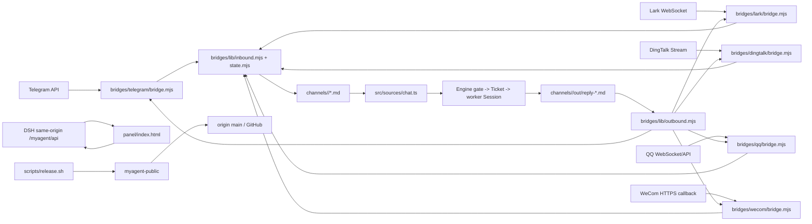

# Surfaces / Release 逐文件审核（本委派范围收口，未审项显式保留）

> 范围：bridges 下全部 `.mjs`/`.js`、`panel/index.html`、`client.js`、`scripts/*`、`prompts/*`、配置/manifest/build 文件、`package.json`、README/SECURITY/CHANGELOG 及相关测试关键部分。仅本报告落盘；未读文件保持“未审”。基线与纪律见 [38-topology-audit.md](/Users/liyang/Documents/SA/myagent/docs/v2/38-topology-audit.md)。

## 操作日志

- A-S001（完成）：先读纪律文件全文（34 行）并创建本报告。只读 `pwd; ls -la /Users/liyang/Documents/SA/myagent` 与 `git ls-files ...` 均成功（工具未显示数值 exit marker，未捏造）；确认工作目录 /Users/liyang/Documents/SA。glob 以带层级模式在仓库根查找出现无匹配；改以各实际子目录 `*`/`**/*` 列举，已获得桥/脚本/提示词清单。未读 node_modules。
- A-S002（完成）：全文读取 scripts/release.sh 1–561、gate.sh 1–280、verify-live.sh 1–126、verify-migration.sh 1–92、client.js 1–61、bridges/lib 七文件；panel/index.html 与 verify-browser.mjs 输出达到工具上限，暂只读至 614/786，仍为未审全篇。未执行这些脚本。
- A-S003（完成）：全文读取 Telegram bridge 273/transform 138、Lark 237/125、DingTalk 202/98、QQ bridge 347/protocol 108/transform 93、WeCom bridge 248/crypt 75/transform 66；六份桥 README（根 173、Telegram 104、Lark 141、DingTalk 50、QQ 59、WeCom 65 行）与两个桥 package.json 各 16 行；全文 package.json 97、cordis.patch.yml 203、tsdown 13、tsconfig 21、vitest 9、三提示词 worker 130/orchestrator 105/triage 107、README 455、SECURITY 154、CHANGELOG 42。tests/bridges.spec.ts 全文 1032、build.spec.ts 全文 55；verify-browser 全文 1212。未运行测试与浏览器。
- A-S004（完成）：panel/index.html 已全文读取 1–4925；verify-browser.mjs 已全文读取 1–1212。发现 SR-16/17/20/21；面板未执行、未启动浏览器。
- A-S005（完成）：纯 Node 独立企业微信长度封装样本仅在内存构造并交现有 decrypt；退出码 0，输出已记录 SR-00；无网络、无桥入口、无仓库外落盘。
- A-S006（完成）：补读 src/sources/chat.ts 1–761（用于 Source 接缝/原子认领/HTTP 拓扑）、src/app/http.ts 1–230、510–669、710–735、755–849、src/core/policy.ts 1–75；确认 HTTP settings PUT 无 revision/If-Match，见 SR-17。未读其余 src，保持未审。
- A-S007（完成）：补读 tests/chat.spec.ts:649–724（桥套件↔真实 ChatSource 双向契约）与 tests/worker-preset.spec.ts 全文 87；证明仅契约/研究 preset 关键路径，未运行。

## 拓扑（本范围静态/运行时边）

边界：桥凭据只在各自 env/进程；panel 只生成守护文本，不启动桥；Source 只认顶层 `.md`，点文件/`out` 不入站；入站临时写后 rename，Source unlink 后归档；出站发送成功后才 rename 到 sent，但至少一次窗口仍在。release rsync/脱敏/扫描后改版本与 commit/push，最终扫描与最终索引不一致（SR-03）。

## 覆盖台账与未审

已全文：`bridges/lib/{frontmatter,inbound,outbound,state,run,route,log}.mjs`；`bridges/{telegram,lark,dingtalk,qq,wecom}/{bridge,transform}.mjs`（qq 另 `protocol.mjs`，wecom 另 `crypt.mjs`）；六份桥 README；`client.js`；`panel/index.html`；`scripts/{gate,release,verify-live,verify-migration}.sh`、`scripts/{verify-browser}.mjs`；`prompts/{worker,orchestrator,triage}.md`；`package.json`、`cordis.patch.yml`、`tsconfig.json`、`tsdown.config.ts`、`vitest.config.ts`；`README.md`、`SECURITY.md`、`CHANGELOG.md`；`tests/bridges.spec.ts`、`tests/build.spec.ts`，以及 `src/sources/chat.ts`、`src/app/http.ts` 选定行段、`src/core/policy.ts` 选定行段。

保持未审：其余 `src/**`、除上述两份外其余 `tests/**`（含 `tests/chat.spec.ts` 仅 grep 未全文读）、`pnpm-lock.yaml`、`.gitignore` 仅全文读但未纳入生产覆盖、隐藏/未跟踪文件、`examples/**`、`locale/**`、`docs/**`（除 38-topology-audit.md）、各 README 链接外部文档。未执行构建、安装、测试、浏览器、发布、远端 API；未修改生产代码/测试/运行态。

## 逐文件覆盖（增量）

| 文件 | 覆盖 | 结论/边界 |
|---|---|---|
| scripts/release.sh | 全文 1–561，已审 | 见 SR-01/02/03；脚本未经执行 |
| scripts/gate.sh | 全文 1–280，已审 | 树哈希未采样 client.js、CHANGELOG/SECURITY、lock 与 tsdown 配置；随包清单部分覆盖 |
| scripts/verify-live.sh | 全文 1–126，已审 | 标记头/Origin/读取与预览验证；未运行 |
| scripts/verify-migration.sh | 全文 1–92，已审 | 见 SR-04；未运行 |
| scripts/verify-browser.mjs | 全文 1–1212，已审 | 硬编码 `require('~/deepseek-harness/...')` 不展开波浪号；旧 UI 断言（195、828）与当前标题/三分区漂移；未执行 |
| client.js | 全文 1–61，已审 | 只注入 /myagent/ 链接、locale 订阅和卸载注销；无请求/凭据 |
| panel/index.html | 全文 1–4925，已审 | SR-16/17/20/22；DOM 外来文本多数 textNode，未发现可直接确认的 XSS |
| bridges/telegram/bridge.mjs | 全文 1–273，已审 | SR-08/14；env token；fetch 无应用层超时；30 分钟安静即退出且 lastInboundAt 不重置，重启可持续循环 |
| bridges/telegram/transform.mjs | 全文 1–138，已审 | chat+message ID；群 @/DM/allowlist；附件仅提取引用 |
| bridges/lark/bridge.mjs | 全文 1–237，已审 | 官方 SDK；并发 tick/state 竞态 SR-12/18；业务非零 code 未显式核验，需 SDK 行为确认 |
| bridges/lark/transform.mjs | 全文 1–125，已审 | text/post；未知 bot id 降级任意 @；完整 route |
| bridges/dingtalk/bridge.mjs | 全文 1–202，已审 | webhook 有效期；SR-06/12/15/18；文件未实现仍最终归档 |
| bridges/dingtalk/transform.mjs | 全文 1–98，已审 | 文本、会话 ID；缺有效期默认允许 POST |
| bridges/qq/bridge.mjs | 全文 1–347，已审 | SR-12/13/14/18；session seq 在落盘前推进，仅内存恢复 |
| bridges/qq/transform.mjs | 全文 1–93，已审 | 群清理首 token、附件 URL 直接使用；未验证 URL host |
| bridges/qq/protocol.mjs | 全文 1–108，已审 | 纯 op/路径构造；不涵盖实际业务码/transport |
| bridges/wecom/bridge.mjs | 全文 1–248，已审 | SR-10/11/12；公网请求、立即 ack、强制退出 |
| bridges/wecom/transform.mjs | 全文 1–66，已审 | SR-10；XML 简易字段提取；agent 不是会话用户 |
| bridges/wecom/crypt.mjs | 全文 1–75，已审 | SR-00/09；独立样本不兼容 |
| bridges/README.md | 全文 1–173，已审 | 契约/权限/至少一次；“唯一依赖桥”等文案已漂移 |
| bridges/telegram/README.md | 全文 1–104，已审 | daemon env/权限；验收“同一消息发两次只有一票”需区分平台重投与两条新消息 |
| bridges/lark/README.md | 全文 1–141，已审 | SDK/平台验收边界；历史声明未作当前证据 |
| bridges/dingtalk/README.md | 全文 1–50，已审 | “文件留 out”与 SR-06 实现不符；心跳写5秒而代码默认3秒 |
| bridges/qq/README.md | 全文 1–59，已审 | 历史 READY 不能证明当前收发；回执未做 |
| bridges/wecom/README.md | 全文 1–65，已审 | “文件留 out”与 SR-06 不符；加密仅自循环 |
| bridges/lark/package.json | 全文 1–16，已审 | SDK ^1.53.0 无本地 lock，装依赖漂移未实测 |
| bridges/dingtalk/package.json | 全文 1–16，已审 | SDK ^2.0.4 无本地 lock，装依赖漂移未实测 |
| package.json | 全文 1–97，已审 | lib/client/manifest/panel/prompts/bridges 随包，scripts/tests/docs 不进 npm files |
| cordis.patch.yml | 全文 1–203，已读静态审 | worker/researcher 两预设；researcher 去 shell，subagent 继承对应预设；未查询宿主schema，因此不认证实际DSH兼容性 |
| tsdown.config.ts | 全文 1–13，已审 | src/index.ts→lib/index.js+d.ts；clean true；DSH/zod external；本轮未构建 |
| tsconfig.json | 全文 1–21，已审 | strict，无 JS typecheck；桥入口不在 include |
| vitest.config.ts | 全文 1–9，已审 | tests/**/*.spec.ts；桥入口不会直接导入执行 |
| .gitignore | 全文 1–10，已审 | 顶层lib与私有blacklist排除；未读取私有blacklist内容，当前密钥扫描表有效性未审 |
| prompts/worker.md | 全文 1–130，已审 | scope/报告、注入数据与继承边界明示；66与72父目录读权限说法有歧义；能力限制须以工具守卫为准 |
| prompts/orchestrator.md | 全文 1–105，已审 | 主会话分诊/派活；88称同Work sharing未实现，与SECURITY补充漂移 |
| prompts/triage.md | 全文 1–107，已审 | 52不确定先drop与104–107不确定需开票冲突；仅提示词约束 |
| README.md | 全文 1–455，已审 | 46称去掉Thread但81开始介绍Thread；317称chat只文本与桥附件实现漂移；历史声明未认证 |
| SECURITY.md | 全文 1–154，已审 | 单用户/完全访问/无认证边界明示；历史扫描不作当前证据；152预算“无上限”需结合墙钟实现更新 |
| CHANGELOG.md | 全文 1–42，已读审 | 仅版本记录，不证明相应功能已验收 |
| tests/bridges.spec.ts | 全文 1–1032，已审 | 映射/公共套件/QQ纯协议；不导入桥入口，无offset/业务码/tick重叠/同名附件故障用例；WeCom仅自循环 |
| tests/build.spec.ts | 全文 1–55，已审 | mtime/schema/旧表字串；不证明字节对应当前源码 |
| tests/worker-preset.spec.ts | 全文 1–87，已审 | researcher→Session预设装配；不涵盖panel字段丢失 |
| tests/chat.spec.ts | 649–724已审；其余未审 | 双实现契约成功/未映射路径；未覆盖真实网络 |
| tests/panel.spec.ts | 130–174、1857–2086、3910–4004已审；其余未审 | SR-22测试缺口；单元生成未覆盖特殊路径 |
| src/sources/chat.ts | 全文 1–761，接缝已审 | 入站身份映射/订阅接缝、回信写文件；见下方拓扑证据 |
| src/app/http.ts | 1–230、510–669、710–735、755–849已读审，其余未审 | sameOrigin仅头围栏；settings无CAS；desk latestSeq窗口 |
| src/core/policy.ts | 1–75已读审，其余未审 | ScheduleSchema的3个新字段对照SR-22 |
| bridges/lib/frontmatter.mjs | 全文 1–68，已审 | 单行 scalar 消除换行，解析宽松；需与 Source 核对 |
| bridges/lib/inbound.mjs | 全文 1–104，已审 | 同目录随机临时文件+rename；附件下载无限字节读取，见 SR-07 |
| bridges/lib/outbound.mjs | 全文 1–229，已审 | sent 按文件名去重；多片进度与附件故障见 SR-05/06 |
| bridges/lib/state.mjs | 全文 1–30，已审 | 临时+rename 原子可见；read-modify-write 无并发串行化；解析/权限失败均 {} |
| bridges/lib/run.mjs | 全文 1–76，已审 | 顺序 poll、退避、信号只设置 stopped，不中断正在 await 的 poll |
| bridges/lib/route.mjs | 全文 1–71，已审 | dm/group/topic 完整坐标；旧 thread 使用 replyRoutes/defaultChat |
| bridges/lib/log.mjs | 全文 1–51，已审 | 日志直接序列化外部 error.message/cause；无通用凭据过滤 |

## 已确认与候选问题（仅当前代码证据）

### SR-00 · 独立企业微信封装验证（确认，高置信度）

操作 A-S005：未启动桥、未联网、未改仓库；仅用 Node `createCipheriv` 构造独立 `[16字节随机前缀][4字节大端 XML 长度][XML][corpId]`、关闭自动 padding 的标准样本，再调用现有 `bridges/wecom/crypt.mjs:decrypt`。命令退出 0，输出 `{"same":false,"error":"error:1C800064:Provider routines::bad decrypt","pad":32}`。这不是官方向量，但与实现的消息封装差异可复现：现有 decrypt 预期 `body.subarray(16, body.length-corpId.length)`，没有读取/校验 4 字节长度；同时 createCipheriv 未关闭默认 padding，现有自定义 32-byte unpad 与标准样本不兼容。保留 SR-09 为候选转确认前的代码证据；本条是独立样本实证，仍需正式官方样本最终确认。

### SR-16 · 面板生成 launchd/systemd 文本未转义用户路径（中，置信度高）

位置：panel/index.html:3297–3302、3331–3374。触发：操作者在“仓库绝对路径”或 env 路径输入包含空格、`$()`、反引号、引号、换行等字符，并复制/安装生成单元。证据：`repo.replace(/\/$/,'')` 后直接拼入 `ExecStart=/usr/bin/env node ${script}`；launchd 更直接放进 `/bin/sh -c ... exec /usr/bin/env node ${script}`，仅 env 文件包在双引号中。影响：合法含空格路径无法按预期启动；恶意或误填路径在操作者执行生成的 launchd 单元时可被 shell 解释，造成命令注入/启动错误。面板自身没有自动执行，故边界是“复制/安装单元”触发；应对路径做 shell/plist/systemd 各自转义或只接受校验后的绝对路径。

### SR-17 · 面板排期/设置保存是整份文档重写，异步并发会丢更新（中，置信度中高）

位置：panel/index.html:3118–3128、3462–3484、3518–3541、4215–4221、4887–4901。触发：两个标签/操作者同时保存 settings，或面板旧 state 读后另一处已更新。证据：各函数从缓存 `state.settings` 复制整份 JSON，再 PUT；Desk 保存先另 GET state 再改 `settings.deskLlm`，无 revision/If-Match；频道、身份、排期同样基于本地 state。影响：后写请求覆盖先写请求的其他字段（例如映射、频道、排期、deskLlm），导致静默配置回退。后端是否有并发拒绝需看 HTTP/settings 实现；面板自身没有防护，故列为确认的客户端竞态。

### SR-18 · 桥状态文件 read-modify-write 无锁，跨进程/重叠路径可丢字段（中，置信度高）

位置：bridges/lib/state.mjs:23–29；调用方 lark:127–134/183–186、qq:138–148/185–187、telegram:145–152/174–175/199–205、wecom:115–123/205–207、dingtalk:104–112/145–146。触发：同一桥的 inbound 与 outbound 同时 saveState，或误启动同目录双实例。证据：每次先 loadState，再 spread patch，再 rename；无 mutex、版本号、compare-and-swap。影响：较晚写者以旧快照覆盖另一写者字段（offset、replyRoutes、sentMessages、lastOutbound 等）；双实例还会互相覆盖临时状态，导致重复/漏收/错路由。README 虽明示“一应用只能一桥”，代码没有单实例锁。

### SR-19 · 面板“启用频道”操作不能确保桥进程存在（低，置信度高）

位置：panel/index.html:3502–3509、3739–3782；src/sources/chat.ts:342–357。触发：启用已配置频道但桥未启动。证据：面板只 PUT settings 并 `POST pass`；Source 只扫描目录、把 heartbeat 缺失解释为旧桥无承诺（不报错），不会拉起桥。影响：操作员可能看到“启用/正常”而消息永远不进，需依赖待回信/心跳人工发现；这是设计边界而非代码崩溃，但发布拓扑必须明确“面板不托管桥”。

### SR-01 · 发布路径缺乏目标身份/脏树保护（高，置信度高）

位置：scripts/release.sh:29–31、245–251、349、364–369、495、531。触发：myagent-public 是含 `.git` 的错误仓库、symlink 指向其他仓库，或副本有未提交修改。代码仅验证源脚本路径和目标 `.git` 目录，没有 realpath/源目标互异/remote/branch/clean 检查，随后 `rsync -a --delete "$SRC"/ "$PUB"/` 与 `git add -A`；dry-run 也覆写工作树并 `git reset -q`。影响：覆盖/删除错误目标内文件，混入他人改动或清除原暂存状态。REPO 常量只用于事后 gh API，push 使用实际 origin，二者可不一致。需要发布前锁定 canonical 目标与 origin、当前分支和 clean 状态；本轮未触碰 myagent-public。

### SR-02 · 提交失败被当作无变更，仍然 push（高，置信度高）

位置：scripts/release.sh:534–535。触发：commit 因 hook、身份或磁盘故障失败（不仅是“无变化”）。证据：`git commit ... || { echo "（没有变化可提交）"; }` 后无条件 `git push -q origin main`。影响：推送未必包含本次发布的旧分支，或推送本来待发的其他提交；与“任何一步失败不推送”注释不符。应区分 staged diff 为空与 commit 非零失败。

### SR-03 · 最终暂存字节未全部扫描（中，置信度高）

位置：scripts/release.sh:504–520。触发：VERSION 含意外内容（完全未校验 semver）或第 5 步之后文件被并发写入。证据：scan_staged_bytes 在版本重写前；Python 接受任意 VERSION 写 package.json，随后第二次 `git add -A`，未复扫；检查树静止也早在 327–330。影响：最终发布索引与扫描索引不同；外部版本字符串可带泄漏内容，最终树不受验收证据覆盖。应在所有改写后冻结并扫描精确最终索引。

### SR-04 · 迁移演练的快照与成功判定不可靠（高，置信度高）

位置：scripts/verify-migration.sh:37–41、47–51、65–68、75–85。触发：按默认说明对仍运行的 WAL 数据库演练，或 Store 启动迁移失败。证据：默认 LIVE 无停机检查，却以 immutable=1（忽略 WAL）打开；注释自行假定 host stopped。node 管道末尾 `|| true` 吞异常；后续只检查 artifacts 存在与 settings 不在，不验证目标 schema 版本。回滚只把版本设 1 再摘要，未真正打开旧构建。影响：快照可漏未 checkpoint 数据，失败迁移/并未迁移可能仍被后续陈旧形状“通过”，不能证明回滚兼容。未访问数据库，静态证据。

### SR-05 · 多片发送进度不足以保障崩溃/后置失败去重（中，置信度高）

位置：bridges/lib/outbound.mjs:156–180、199–201。触发：某片已被平台接收后进程崩溃、onSent 写状态失败，或最后 rename 失败。证据：只有后续某片 catch 时才写 progress（177），每片成功不落盘；onSent 与 send 同一个 try，onSent 失败判本片未发送；全部成功后先删 progress 再 rename。影响：重启从旧片号/0 重发；单片同样有平台接受到 sent 归档之间的至少一次窗口。不能宣称恰好一次；需要平台幂等键/持久回执和准确语义。

### SR-06 · 附件失败仍归档整条回信，永久不重试（中，置信度高）

位置：bridges/lib/outbound.mjs:183–201。触发：附件不存在、超限、平台拒绝、网络错误，或该平台未提供 sendFile。证据：全部异常 warn 后继续；没有 sendFile 直接跳过文件；最终 rename 到 sent。影响：正文可能显示“已发送”而附件丢失，后续 drain 按名称跳过，无法自动恢复。应跟踪每附件状态并明确部分送达。

### SR-08 · Telegram 在入站持久化前推进游标，失败即永久跳过（高，置信度高）

位置：bridges/telegram/bridge.mjs:225–229。触发：saveState(offset) 成功后 writeMessage 因磁盘/权限等失败，或两者之间退出。证据：先持久化 update_id，才 await inbound；下一轮 offset = state.offset + 1（220）。影响：该 update 不再获取，文件/Trigger 不存在；确定性文件名不能补救从未写成功的消息。必须成功持久化入站后再推进 offset。

### SR-09 · 企业微信密码实现与官方消息封装不一致（高，置信度高，尚无官方向量运行）

位置：bridges/wecom/crypt.mjs:43–61。证据：明文拼接仅 `[random16][xml][corpId]`，缺少 WXBizMsgCrypt 的 4 字节网络序消息长度；createCipheriv/Decipheriv 未 setAutoPadding(false)，因此又叠加 Node 的 16 字节 PKCS7，代码再自定义 unpad32。影响：自家 encrypt/decrypt 往返可互相通过，但真实平台密文长度/填充会被误读或直接拒绝，合法 callback 无法正确写消息。应以官方向量核验，当前测试自循环不足以证明兼容。此结论来自现有实现与明确封装结构差异，不采用历史成功声明。

### SR-10 · 企业微信回信路由把 agentId 当用户（高，置信度高）

位置：bridges/wecom/transform.mjs:53–59；bridge.mjs:115–120、183–195。触发：任一正常入站含 AgentID，例如 1000002。证据：thread=`dm:1000002`；routes[thread].touser=真实 from，但出站 `touser = route?.chatId ?? carried?.touser` 优先选 1000002。影响：回信发给错误 userid/被平台拒绝；所有用户还共用同一 thread，最后用户覆盖 carried。thread 应是实际会话用户坐标，不能是 app agent 坐标。

### SR-11 · 企业微信先应答成功后持久化，无界未认证请求体（高，置信度高）

位置：bridges/wecom/bridge.mjs:152–169、239–240。触发：公网 callback 端口收到大 POST，或成功校验后磁盘失败/进程退出。证据：所有 data 块先进入数组再验证，无大小上限；finish(200,'success') 在 onInbound(writeMessage) 前。影响：无需签名即可占用内存，合法消息在入站落盘失败时平台已得到成功不再重推。需流式限额与 durable-write 后 ack。

### SR-12 · 四个 push 桥出站 tick 可重叠（高，置信度高）

位置：lark/bridge.mjs:204–215；dingtalk/bridge.mjs:162–172；qq/bridge.mjs:211–221；wecom/bridge.mjs:220–230。触发：一次网络发送耗时大于默认 3 秒。证据：setInterval(() => void tick()) 无 inFlight 锁，drainOut 读取同一 out 列表，发送前无 claim/rename 锁。影响：多个 tick 可重复发送同一条、重复 multipart、竞争 seq/state/rename。仅 Telegram supervise 顺序 await poll。所有 push 桥的信号处理直接 process.exit，亦可在发送/落盘中断。

### SR-13 · QQ 把“被动门关闭”业务错误当成功（高，置信度高）

位置：bridges/qq/bridge.mjs:109–110、158–166、182–199。触发：HTTP 2xx 返回 code 304023 或 304024。证据：post 的 ok 显式包含两码；sendPassive 注释把它们解释为 window closed/refused，却以 result.ok 返回 seq；因此从不走 active fallback。影响：未送达回信被归档 sent，并记录成功。需先判业务错误，再决定 fallback。

### SR-14 · 已命名入站附件跨消息覆盖（高，置信度高）

位置：telegram/transform.mjs:89–92 → bridge.mjs:129–131；qq/transform.mjs:64–69 → bridge.mjs:128–130；lib/inbound.mjs:91–102。触发：不同用户/消息上传同名 report.pdf 或 QQ 缺名默认 attachment-1.jpg。证据：Telegram ref.fileName 优先于 msgId 前缀，QQ 直接使用 filename；统一落 attachments/<safe> 并 rename 覆盖。影响：已入站请求记录引用同一路径，其附件在 worker 拷贝前可被后续消息替换，导致任务使用错误/恶意内容。应按消息 ID 建隔离命名空间。

### SR-15 · 钉钉回信 webhook 凭据以默认权限写入状态（中，置信度高）

位置：dingtalk/bridge.mjs:104–109；lib/state.mjs:26–28。触发：常见 umask 022 的桥进程收消息。证据：sessionWebhook 写入 .bridge-state.json，writeFile 未设 mode；新临时文件通常 0644，rename 保持权限。影响：本机其他用户可读 webhook（有效窗口内具有发信权限）；env 文件 600 无法保护从平台载荷导出的 bearer URL。应目录 0700、状态 0600 并限制错误日志内容。

### SR-20 · 面板 Desk history 增量读取可能永久漏消息（中，置信度中）

位置：panel/index.html:4821–4831；HTTP src/app/http.ts:641–645。触发：一次返回正好 50 条（limit 上限）且服务端还有更多历史时，或历史被截断/清理导致 seq 不连续。证据：客户端只把 `deskSeq = body.latestSeq` 设为服务端最新序号，而不是本次最后一条；下一次 `after=latestSeq` 会跳过本次返回中可能未读完的尾部（如果 latestSeq 超过返回窗口），且“加载更多”按钮在 50 条时仅显示但没有任何绑定处理（仅 `$('desk-load-more')` style 被设置，未见 click handler）。影响：总管对话历史可能只显示窗口头、点击加载更多无效，操作员无法审计完整记录。需用 `latest returned seq` 推进，并为加载更多绑定向前/分页语义。

### SR-21 · panel desk save 原地修改响应对象（候选，低置信度；不作为确认缺陷）

位置：panel/index.html:4893–4901。代码确实 `const settings = cur.settings; settings.deskLlm = ...` 后 PUT，但当前 `api()` 每次 JSON.parse 返回新对象，未发现共享/冻结证据；因此仅记录实现脆弱性，不宣称会污染运行态。若 PUT 失败，局部 `cur` 对象随请求结束不可见，影响目前未复现。

### SR-22 · 排期编辑/开关/删除会静默丢失新字段（高，置信度高）

位置：panel/index.html:4129–4133（`toRecord` 只保留 id/name/enabled/prompt/scope/timing）、4180–4183（`collectSchedule` 同样只采集六字段）、4215–4221（保存整份 schedules）、4243–4253（启停/删除先 `schedules.map(toRecord)`）；对照 `src/core/policy.ts:36–65`，ScheduleSchema 还含可选 `deliverTo`、`maxRuntimeMs`、`preset`。触发：已有排期含任一新字段时，在面板打开排期并保存、停用/启用或删除任一排期（这些操作都会重写整份数组）。证据：GET view 会显示 `deliverToText/budgetText/presetText`，但 `toRecord` 不回传原字段；保存后 schema defaults 将 `maxRuntimeMs` 置 0、`preset` 置 worker，`deliverTo` 消失。影响：报告送达聊天室被移除、预算取消、researcher 无 shell 安全边界退回普通 worker；这是配置安全/发布行为破坏，且 UI toast 仅“已保存/已停用”。现有 tests/panel.spec.ts:1921–1930 只断言六字段，反而无法发现该回归。应保留并编辑完整字段，或后端做字段级 patch/revision。

### SR-07 · 通用附件下载无字节上限（中，置信度高；可达性待逐桥核对）

位置：bridges/lib/inbound.mjs:86–102。触发：允许消息携带很大远端资源。证据：fetch 只限制 30 秒，`response.arrayBuffer()` 全量入内存，再写磁盘，无 Content-Length/流式上限。影响：内存/磁盘耗尽；文件名仅清洗与截断，相同安全名称会覆盖。需结合调用方的 ID 前缀和 URL 来源判定覆盖/SSRF 可达性。
