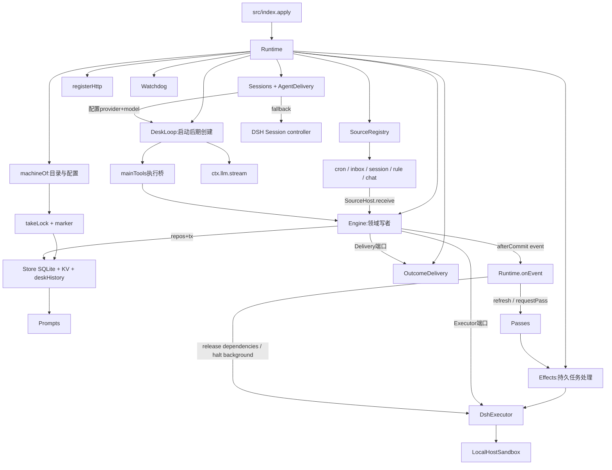
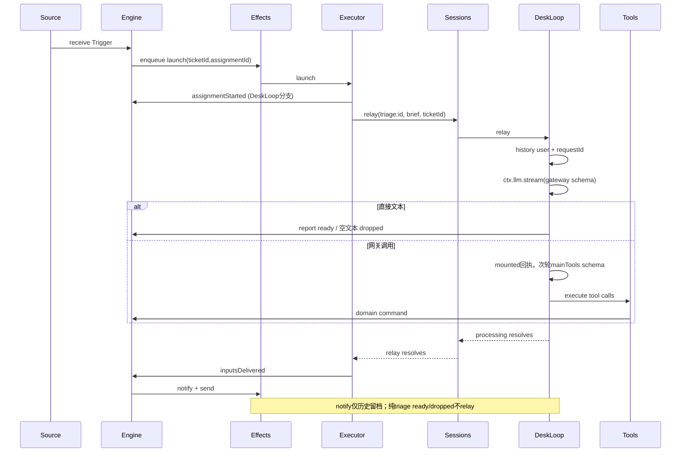
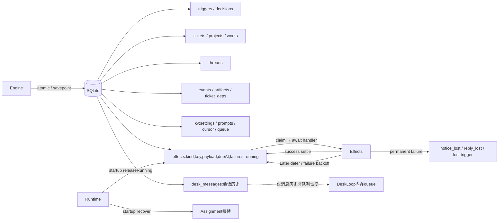

# 项目拓扑（审核进行中）

基线 a06e999；静态文件清单 inventory.json（387文件），导入边 imports.json（729条，含类型与外部库，不等于运行调用图）。本图只写已核实的边，后续增补。

## 1. 身份与发布边界

- 本体：~/Documents/SA/myagent；公开镜像：myagent-public（发布脚本待独立审查）；运行态：DSH_HOME/state/myagent。
- package.json:7入口 lib/index.js；types lib/index.d.ts；client client.js；Cordis bundle patch cordis.patch.yml。运行时提示词、面板、桥、示例、locale是磁盘文件，不在bundle中（package.json:18–29）。
- src/index.apply → Runtime构造 → skills注册 → ctx.effect(runtime.stop) → Runtime.start（src/index:41–85）。构造失败只log，启动失败markProblem。

## 2. 装配图（runtime.ts:327–520）

细节：Executor/Sessions/Delivery在Engine之前构造，使用闭包或getter延迟取Engine，构造阶段不得提前调用。SourceRegistry在Passes之后创建，HTTP在Runtime构造末尾注册。

## 3. 启动与关闭时序

启动（runtime:1260–1317）：indexSessions → wireAgents → **recover** → refresh → sources.sync → passes.start → watchdog.start → **new DeskLoop/init → setDeskLoop** →清理ended会话健康。

关闭（runtime:1387–1421）：stopped=true → Runtime.abort → disposers(reverse) → watchdog.stop → passes.stop → sources.stop → sessions.dispose → effects.dispose → executor.halt(open running) → store.close → lock.release。DeskLoop没有出现在关闭序列，其私有abort未与Runtime关联（desk-loop:80/244）；见RT02。

## 4. 分诊执行与回信

风险边：Effects如果顺序await launch，DeskLoop内触发依赖effects的副作用是否阻塞，需对Effects/Passes交叉审查；report先于inputsDelivered会使已结束Assignment投递标记丢失，需核对领域守卫。

## 5. 工具拓扑与信任

Runtime.sessionsHost.tools:472–482：普通worker=workerTools；专职triage=mainTools + 仅myagent_report(worker绑定)；操作者main=mainTools。不是“triage只有workerTools”。DeskLoop=deskToolSchemas(mainTools)+首轮gateway，直接executeDeskToolCalls可调主工具；模型工具调用必须核对具体schema和范围。

Runtime.toolsHost:526–543把engine/store、attempt、artifact读取、回信、晋升技能、决断队列、askDesk交给工具。askDesk为fire-and-forget relay，catch吞异常且立即sent=true，成功语义需审核。

## 6. 尚待完成的拓扑

HTTP完整路由图、事件全部生产者/消费者、effects key与重试图、SQLite表与事务/迁移图、bridge原子文件协议、worker工具权限与preset图、面板请求图、测试映射、发布镜像/脱敏边界。

## 7. 审核结果边界与确认问题

### 静态/隔离实验确认的高风险边

1. `runtime.start:1260–1290` 的 `recover → new DeskLoop → setDeskLoop` 顺序，使 `runtime.recover:1585–1594` 的 main-desk triage 重排队条件在启动时为 false；隔离探针 RT01 复现 `assignmentInterrupted=0`。
2. `desk-loop.ts:174–186` 的超时关闭没有判断 Assignment role；任意带 `ticketId` 的 relay（包括 worker 的 askDesk）超时都尝试 `engine.report(dropped)`。隔离探针 RT08 观察到 worker id 收到 dropped report。
3. `desk-llm.ts:56–74` 未把 AbortSignal 放进 `GenerateOptions.signal`；隔离探针 RT07 观察 provider options.signal 为 undefined。底层 stream 若不自行返回，调用层 abort不能取消 provider。
4. `desk-loop.ts:265–269` 对所有无 toolCalls 的文本走 ready；finish reason 为 error 但带部分文本时仍结案。RT11 观察到 partial text → ready。
5. `desk-loop.ts:326–330` 以整个 Assignment 期间的 `replied` 事件阻止后续直答结案；RT09 观察到旧 reply 使后续 requester answer 无 report。
6. `DeskHistory` requestId 只去重持久 user row；`DeskLoop.relay` 仍执行两次 LLM，RT10 观察 user rows=1、provider calls=2。
7. `LocalHostSandbox.materializeInput:299–310` 对既有目标仅比较 size；RT06 观察同长度不同内容保持旧字节却报告成功。
8. `lock.ts:79–84` foreign-host lock 可被 unlink；CORE01 复现。
9. `Memory.atomic:154–175` 未 snapshot threadStore；CORE04 观察 Memory rollback 后 thread 残留、SQLite rollback 后不存在。
10. `Prompts.save/saveSkill/...` 分两次 KV 写；SUP01 注入 revision 写失败后 config 已变而 revision保持0。

### 其他审核报告确认的边

- Chat context fan-out 对 ended/deleted subscription 可能在主消息 take 后抛错，导致后续 context 丢失（core-sources报告）。
- Watchdog 在 reportSilent 前加入 reportedSilence，report失败后同 attempt 告警永久跳过（core-sources报告）。
- Telegram 入站先推进 offset；WeCom封装/回路由/ack、QQ拒绝码、四桥重叠tick、附件同名覆盖、release脚本提交失败仍push均有静态证据（surfaces报告）。
- 面板排期转换丢 deliverTo/maxRuntimeMs/preset，保存/启停/删除整表重写会破坏预算、预设和送达配置（SR-22）。
- 测试假桩不能证明真实 DSH cancel/idle/disposer；附件物化有条件降级；HTTP bad-json用例实际空body；desk-tools没有成功管理工具真实调用。历史37号关于“新增 executor DeskLoop/follow-up专项测试”的说法与当前测试树不一致。

## 8. 不能过度解释为发现的事项

- `sends.queued` 是进程累计入队计数，不是待处理 effects数量；effects表为空时不能报积压。
- `triage.md` 使用 `myagent_report` 与 `orchestrator.md` 使用 mainTools 是 dedicated/main 两种模式差异；缺模式注释是可读性问题，不是工具注册漂移。
- about CHANGELOG 空页候选已被 panel.spec 的空 changes UI断言反证，撤回。
- 旧验收文档的数字、schema、hash只代表当时产物；当前全项目审核不将其升级成当前真机证据。

## 9. 文件/模块覆盖计数（2026-11-13）

- 受控文件清单：387；src 41（14,966行）；旧测试50（24,338行，含helpers及本轮前旧spec）；bridges 27（3,263行）；panel 1（4,925行）；scripts 5（2,271行）；prompts 3（342行）；docs 38（20,576行）；examples 206（125,457行，27个Python脚本）。
- Audit38新增产物不在初始git inventory：38-topology、audit38报告/索引/证据、tests/audit38-repro.spec.ts。它们属于审核工程，不得误算成原有功能覆盖。
- AST索引：978符号、548 import、233动态注册/事件/效果边；静态导入仅提供候选拓扑，运行时边由runtime-review及各分报告核实。
- 文档链接检查：84个相对本地链接，13个缺失，主要为历史`/tmp/myagent-*`证据；不把历史临时文件缺失当源码缺陷，但作为历史可复现性风险记录。

## 10. 持久化与故障恢复图

表结构13张（含schema_version和desk_messages）保存storage-tables.json；完整HTTP52路由见http-routes.md；函数/类型逐位置见symbols.md；事件/效果/KV注册索引见runtime-edges.md。

重试边界：Effects入队以(kind,key)唯一行保证待处理合并，但已settle行不等于永久幂等账本；AgentDelivery依赖Session/inbox历史去重；DeskHistory requestId仅去重消息行；bridge sent文件仅在平台发出并归档后去重。四层幂等语义不同，不能合并成“恰好一次”。

## 11. 完成范围与验证结果

39/39项目Markdown目标全文审阅（含本轮38，历史数据事实不重新核验）；47旧spec+3helpers全文，生产src41全文；27历史Python全文。coverage.md记录各文件证据，174个历史数据只枚举/哈希，lib2为生成物身份核查，lockfile仅结构审查（无CVE库）。

最终隔离完整gate退出0、1218/1218（含10条缺陷观测探针），产物2cac4b8c36ee96b6。前次同快照完整gate有1个runtime-budget前置状态间歇失败，定向及全量重跑通过，保留失败日志。不把green gate当结构审核通过。
