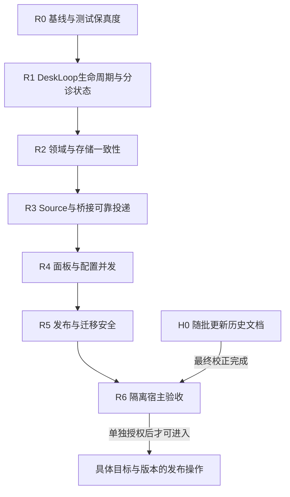

# Audit39 校正修复批次与契约

本文件是39号工程的批次计划，不是执行记录。代码、测试、构建、运行态均未修改。

## 1. 证据等级

- **E0 已复现**：Audit38 隔离探针或独立样本直接观察到错误结果；修复前必须保留最小复现。
- **E1 静态确认**：代码控制流与契约矛盾，触发条件明确；修复前要增加可运行复现。
- **E2 覆盖缺口**：测试桩/条件分支无法证明行为；先补保真度，再判断生产缺陷。
- **H 历史漂移**：文档/旧报告与当前树不一致；不改业务代码，单独校正文档。

## 2. 发现覆盖矩阵

首列方括号前为本工程稳定ID；后面的旧别名仅供追溯。原审核报告存在多个编号体系，以**稳定ID + 问题描述 + 原报告章节**联合定位，禁止把工程编号当作原报告行号。所有行当前状态均为**未开工**；下面“预期处置”是待验证设计，不是已批准的实现。

|工程项/来源描述|基线证据/级别|目标批次|开工前必须补的证据|预期处置|
|---|---|---|---|---|
|R1-01 [P1] Desk恢复顺序（runtime-review RT01 / 汇总 RUNTIME-01）|E0，runtime prototype|R1|真实Runtime重启用例，DeskLoop构造/未配置/active三个分支|恢复先于可判定能力的问题，不能只调一行顺序；确保失败配置也不遗失Ticket|
|R1-02 [P1] DeskLoop stop/join|E1，静态|R1|阻塞LLM stream+stop+SQLite闭库后的写入探针|signal贯通、queue resolve/reject策略、wait current完成后Store.close|
|R1-03 [P1] timeout误drop worker|E0，prototype|R1|worker askDesk真实工具触发 timeout，确认只污染desk不终止worker|超时处role gate；triage timeout dropped；worker timeout可见且不篡改领域状态|
|R1-04 [P1] provider error partial→ready|E0，prototype|R1|error/aborted/max-tokens/finish缺失的provider契约|依据finish reason拒绝把partial当success，保留可见失败文本|
|R1-05 [P2，模式待核] main triage brief/worker report（需按模式复核）|E1，静态历史结论需校正|R1|以dedicated与main两模式捕获完整Prompt和工具registry；Runtime当前triage工具实际为mainTools+myagent_report，不能直接断言“main缺report”|按实际模式修正文案/测试；不可误删triage合法的myagent_report扩展|
|R2-01 [P2] 同大小物化错误当成功|E0，prototype|R2|决定哈希/字节比较成本和并发写策略|目标存在时证明内容一致，不一致明确冲突|
|R1-06 [P1] AbortSignal未给provider|E0，prototype|R1|provider未响应的可取消测试与底层DSH信号契约|信号进入GenerateOptions并保证Runtime stop可达provider|
|R1-07 [P2] prior replied永久挡后续结案|E0，prototype|R1|同一attempt多relay边界，reply事件与requestId关联方案|仅当前turn已追问才保留open|
|R1-08 [P2] requestId重入重复LLM|E0，prototype|R1|并发重复relay与进程重启语义；明确至少一次还是一次|持久执行状态/单flight；外部工具副作用需幂等或补偿|
|R1-09 [P2] Busy/未配置relay resolve但票挂起|E1，runtime静态|R1|无provider、settings从disabled启用、插件reload时队列实际持久性|定义拒绝、等待、恢复政策与端到端验收|
|C01 [P1] CORE-01异机StateLock unlink|E0，lock prototype|R2|明确部署支持单机还是共享FS；多进程/多主机临时目录实验|异机持有者保守拒绝；不能由本机kill(pid)判死|
|C02 [P1] CORE-02 Chat已take后fanout ended ticket中断|E1，静态|R3|ended/deleted subscription多订阅故障用例|过滤失效订阅、逐项隔离异常、主消息与context送达语义分明|
|C03 [P2] CORE-03 Watchdog先dedupe后report|E1，静态|R2|report失败后下一次look的测试|成功后记dedupe或显式失败重试|
|C04 [P2] CORE-04 Memory Thread事务不回滚|E0，双存储probe|R2|同一断言覆盖Thread所有写路径/嵌套savepoint|补snapshots并Memory/Store契约测试|
|C05 [P2] CORE-05 Prompts config/revision分写|E0，Store stub；调用事务边界待核|R2|验证HTTP/Runtime调用方是否包atomic，注入第二写失败|按唯一事务所有者改写，不做重复事务/通知|
|C06 [P2] CORE-06 Inbox readdir错误伪装空|E1，静态|R3|隔离权限/删除目录实验，判定平台可模拟性|IO失败不得record healthy/推进消息游标|
|C07 [P2] CORE-07 Events max(seq)+1并发|E2，竞争风险|R2|两SQLite连接/不带StateLock的竞争探针|唯一seq由SQL/事务原子保证，或明确单写者硬约束与错误处理|
|C08 [P2] CORE-08 Pass stop超时后任务未取消|E1，静态|R2|卡住extra、stop timeout、Store关闭后写入探针|取消或等待/隔离继续工作，数据库生命周期清楚|
|C09 [P3] CORE-09 unknown effect kind永久未claim|E2|R2|注入未知kind、观察健康/移除决策|未知任务告警且不破坏数据，提供人工恢复 |
|B01 [P1] BRIDGE-01 Telegram offset先于入站落盘|E1，静态|R3|写入失败/崩溃窗口、同update重投测试|写入成功后推进offset，文件名与消息身份幂等|
|B02 [P1候选→临时不做] BRIDGE-02 WeCom Crypto格式|E1/协议候选；独立样本不兼容（crypt.mjs:57缺4字节长度，autoPadding叠加）|R3→暂停|**用户决定 2026-11-13：临时不做，等官方向量或真实平台回调**；取得可信官方测试向量并记录出处前，该桥加密兼容性标"未验收/候选"|标准长度字段/padding/signature兼容；成功/拒绝/篡改负例分别验证|
|B03 [P1] BRIDGE-03 WeCom agentId作touser|E1，静态|R3|多用户/多Agent回信映射用例|route thread与平台真实会话坐标分开|
|B04 [P1] BRIDGE-04 WeCom未限流/先200后写|E1，静态|R3|超限chunk及write失败测试，外网隔离|有界读取、验证后接收、durable write后ACK|
|B05 [P1] BRIDGE-05 四个push桥tick重叠|E1，静态|R3|超过interval的send延迟、退出中poll测试|单flight/claim；signal时排空当前发送|
|B06 [P1] BRIDGE-06 QQ拒绝码视作成功|E1，静态|R3|真实/fixture 304023/304024并确认fallback/配额|区分HTTP和业务码，成功归档只在真实接受后|
|B07 [P1] BRIDGE-07 附件文件名跨消息覆盖|E1，静态|R3|同channel两个来源上传同名/不同字节并延迟worker|路径按消息身份隔离，不可重写先前已接收附件|
|U01 [P1] UI-01 排期丢deliverTo/budget/preset|E1，静态+panel fixture|R4|field round-trip/save/toggle/delete四路径|完整往返；保留已有未知/新字段或拒绝并发覆盖|
|U02 [P2] UI-02 Desk分页latestSeq跳过/加载更多无handler|E1，静态|R4|>50消息、seq trim、点击Load more|游标取本页最后返回seq，分页方向与trim语义一致|
|U03 [P2] UI-03 生成service路径未shell转义|E1，静态|R4|空格/引号/$()/换行输入，解析生成结果不执行|分别正确转义plist/systemd/shell或拒绝输入|
|U04 [P2] UI-04 settings并发整表PUT覆盖|E1，静态|R4|两个stale revision交错提交|ETag/CAS或字段patch；冲突可见|
|U05 [撤回] UI-05 about CHANGELOG空态|已撤回|不进入修复|panel.spec反证有empty-state处理|不得把旧审核误报变成工作项|
|U06 [候选/P3] UI-06 SR-21局部响应对象修改|候选，未证明共享污染|暂不修复|有新的可观察污染证据才重开|游标问题只归U02；原地修改不是已确认缺陷|
|L01 [P1] REL-01 release目标仓身份/dirty guard|E1，静态|R5|仅临时Git仓模拟各拒绝条件，脚本不得连真源|realpath、remote、branch、dirty、源目标差异均前置拒绝|
|L02 [P1] REL-02 commit失败仍push|E1，静态|R5|hook强制commit失败，核push未触发|空提交与commit失败分开，失败短路|
|L03 [P2] REL-03 最终内容未重新扫描|E1，静态|R5|改version/二次add后注入敏感标记验证|扫描精确最终index/tree，冻结后push|
|L04 [P1] REL-04 verify-migration吞错/漏验schema|E1，静态|R5|临时副本/WAL、新旧构建真实打开/回滚|任何命令错误非零；迁移前后目标schema和业务数据均断言|
|T01 [P2] TEST-01–04 测试假桩/弱断言|E2|R0|每个桩变异让关键断言红|先增强桩及控制组，不将probe通过算feature pass|
|E01 [历史/P2] EX-02–07 examples历史脚本|E1/历史资产，不在运行主链|H0/另批|决定是否继续维护和发布|不阻塞核心；若继续维护则为每工具加离线fixtures/无损写|
|H01 [文档/P2] H-01 文档旧状态与失效证据|H|H0|现状声明逐文档列截止版本/产物|保留历史文字，新增显眼生效版本索引，不覆盖原证据|

### 2.1 补充覆盖项（全为未开工）

|稳定项ID|来源与描述|等级/批次|前置复现与验收|
|---|---|---|---|
|X01|runtime-review RT-04：main triage受worker槽位阻塞|E1/R1|worker全满仍能分诊；分诊不占worker槽；撤回绕过分支应使测试失败|
|X02|runtime-review RT-05：后续附件失败仍标delivered|E1/R1|复制失败不假报全部送达；初始/后续路径同一边界校验；失败重试不重发已送文本|
|X03|app-support tools：blocked缺question|E1/R2|按产品契约确认summary兜底是否有意；若要求具体问题，条件schema拒绝无question，保留旧数据可读|
|X04|app-support files：readForPanel无限额/TOCTOU|候选/R2|先核实所有caller已有上限、普通文件与symlink变化；未证明可达不改边界；真实读取处有界|
|X05|app-support skills：重同步半完成|候选/R2|注册中途失败可见、旧集合/新集合策略明确，失败不悄悄宣称完整注册|
|X06|SR-05：多片回信已发送与进度记录间崩溃窗口|E1/R3|平台幂等键或明确至少一次；每片回执落盘、onSent失败分类、重启不丢待发片；不承诺外部恰好一次|
|X07|SR-06：附件失败仍归档sent|E1/R3|正文/附件分开记账，失败附件可重试且不重复已送正文；不支持文件的平台明确提示|
|X08|SR-07：下载附件无限大小|E1/R3|有界流读取，超限终止并清临时文件；不依赖Content-Length；慢流/重定向测试|
|X09|SR-15：钉钉webhook状态权限|E1/R3|新目录0700/新状态0600，旧权限处理明确；日志不输出webhook/token|
|X10|SR-18：桥state并发覆盖|E1/R3|inbound/outbound交错更新不丢字段；跨进程单实例/锁策略有测试|
|X11|SR-19：启用频道不等于启动桥|设计边界/H0+R4|保留外部桥进程模型；UI明确连接/配置/消息可达三态，不偷偷增加进程托管|
|X12|runtime HTTP：decodeURIComponent在try外|候选/R4|坏percent编码返回可诊断400且不逸出handler；先真实HTTP复现|
|X13|runtime HTTP：events读量无上限|候选/R4|定义分页/上限并保留total/returned；大历史测试不一次读全表|
|X14|runtime-budget间歇前置失败|E2/R0|保存首次失败，改用确定性状态等待；重复/负载验证，禁止仅重跑绿即关闭|
|X15|gate树指纹遗漏配置/client/lock等|E1/R5|从发布边界派生样本；逐项改动使指纹变化，日志/生成证据自引用须排除并说明|
|X16|prompts/README/SECURITY角色与能力陈述冲突|H/H0|逐项版本标注，实际注册与权限证据优先，不靠工具名并集判模式合法|
|X17|app-support about空changes、SR-21响应对象污染、EX-01转义疑点|已撤回/保留候选|不安排生产修复；新证据出现才重开，不能用凑齐清单代替复现|

主矩阵稳定ID为R1-xx/R2-01、Cxx、Bxx、Uxx、Lxx、T01、E01、H01；补充项X01–X17。X17只汇总已撤回/待证状态，不能重复生成U05/U06的修复任务。来源为Audit38相应报告章节；执行批次卡须钉住报告提交、具体行号、源码hash与复现ID。

任何E0/E1问题先补复现。证据重分类必须同步39号总控、覆盖矩阵和处理理由。

任何矩阵项没有测试/变异/回滚字段完整落盘，不能进入“可执行”状态。

## 3. 依赖拓扑



R0先建立可诊断基线和保真测试，不要求尚未修复的缺陷测试此时全部绿：产品回归、预期红的缺陷复现、审核观测探针三类分别报告，不能把预期红吞成成功。后续每修一项将其转换为正确行为回归测试。

执行顺序默认串行：R0 → R1 → R2 → R3 → R4 → R5 → R6；H0随批增量更新，最终状态在R6冻结。并行仅限只读复核或已登记互不共享的工作副本；禁止两个执行者同时改生产文件、tests/helpers、同一spec/fixture、lockfile或生成物。R5在R1–R4候选树冻结后验证发布流程，不能先调用现有不安全release脚本。

文件所有权：R0拥有helpers和通用测试基础；R1拥有runtime/desk/executor/sessions生命周期及其专项测试；R2串行接管Store/Memory/Prompts/Watchdog/Passes与executor物化；R3拥有sources/chat、inbox和bridges及桥测试；R4拥有panel/http和settings CAS端口（Store变动依赖R2）；R5拥有scripts/gate、release、verify-migration和打包验证；H0拥有当前状态与历史更正。共享文件交接必须登记前后hash与提交，禁止自动rebase/重置覆盖他人改动。

## 4. 批次 R0 · 基线、保真度和审核工具（P0）

### 目标

建立不污染日常宿主的隔离profile/stateDir/端口；冻结源码与产物身份；修正测试假桩和审计探针分类；让测试失败能代表真实前置条件。

### 范围

- `tests/helpers/host.ts`：真实模拟 cancel→status、whenIdle 等待、disposer 移除、工具注册替换/解绑。
- `tests/helpers/deployment.ts`：消除固定短等待作为主要判据，统一可诊断的 until-pass。
- `tests/flow.spec.ts`：附件必须验证 inputs 真实字节物化，不允许“目录不存在则只查元数据”的降级。
- `tests/http.spec.ts`/helpers request：构造真正非JSON body、多chunk、流中断。
- `tests/desk-tools.spec.ts`：成功管理工具调用使用真实 Engine/Store（可隔离Memory+Store双实现）。
- `tests/panel.spec.ts`：修复无matcher断言；补删除后负向读取、无关归档、排期新字段。

### 契约

1. 测试桩的状态变化、取消、等待、卸载必须可观察且与生产方向一致。
2. “目录不存在时跳过”不再是有效通过路径；附件断言必须验证文件内容。
3. 审核探针标记为 defect-observation，不计入产品功能测试的“通过覆盖”。
4. 测试辅助改动先跑R0最小测试，再按测试分类报告完整闸门；变异仅在隔离副本实施，禁止改本体生产文件。R0的新缺陷回归若尚未修复可预期红，必须单列预期清单，不能修改退出码把红伪装成绿。

### 验收

- 取消后 agent status/whenIdle/disposer 断言变红于错误实现。
- 附件复制失败、坏JSON、工具成功调用各有红/绿对照。
- M-R0a：恢复旧弱cancel桩→取消/解绑测试变红。
- M-R0b：在隔离副本撤掉附件复制实现，完整字节断言必须变红；不把“删除断言”当作正确的实现变异。

### 回滚

只回滚R0测试与helpers提交；不触碰Store/运行态。若保真桩导致大量既有测试红，先保留失败报告，不能放宽断言。

## 5. 批次 R1 · DeskLoop 生命周期、分诊状态与LLM失败语义（P1）

### 目标

修复启动恢复顺序、停止/取消、超时误drop、错误finish误ready、旧reply永久阻塞、重复requestId重复LLM、空配置/队列遗留票。

### 依赖

R0完成；R1涉及 `runtime.ts`、`desk-loop.ts`、`desk-llm.ts`、`executor.ts`、`sessions.ts`、相关测试，禁止与其他批次并发修改这些文件。

### 契约

1. **恢复**：recover必须在DeskLoop routing capability已可判定后处理main-desk triage；重启不丢running triage。实现可选择“先创建/初始化DeskLoop再recover”或独立持久恢复队列，但必须测试启动失败/未配置时行为。
2. **生命周期**：Runtime.stop必须取消DeskLoop provider、拒绝/排空队列并等待当前turn结束，Store.close之前不得有DeskLoop写入。
3. **角色**：只有`role: triage`且running的Assignment允许DeskLoop直接report；worker超时只能记录错误/中断自己的执行，不能report dropped。
4. **LLM失败**：finish `error`/`aborted`/`max-tokens`不能把部分文本当ready；必须可见地failed/dropped并写Ticket事件。stream必须接受AbortSignal。
5. **回合幂等**：同进程并发/顺序重复requestId应复用执行结果或在途Promise；重启使用持久状态识别“未处理/处理中断/已完成”。外部副作用发生与本地记录提交之间的崩溃窗口不能靠去重行消除：须使用平台幂等键、业务操作ID、补偿或人工待决，不能无证据承诺外部恰好一次。重复事件不得无标记地再次派单/发信。
6. **答复结案**：replied判定必须限于当前relay/turn，而非整个Assignment历史；直接回答应可结案，追问应保持打开。
7. **未配置**：relay进入running triage而DeskLoop不可用时，要有明确转交/排队/失败策略，不得静默resolve永久悬挂。

### 验收与变异

- 重启时running main triage重新入队且role保持。
- stop后provider收到abort、queue promise有明确结果、Store不再写入。
- worker askDesk超时不改变worker Ticket outcome。
- provider error带partial text不ready；aborted/missing provider各有可见结果。
- 同进程无崩溃的顺序/并发重复requestId，目标工具只执行1次；跨崩溃不使用此断言代替外部副作用幂等。
- 旧replied + 新回答能按当前turn正确结案。
- M-R1a：recover顺序退回旧逻辑→恢复测试红。
- M-R1b：去role guard→worker误drop测试红。
- M-R1c：去signal传递→阻塞stream取消测试红。
- M-R1d：error finish改ready→错误语义测试红。
- M-R1e：去request执行去重→重复副作用测试红。

### 回滚

R1任何一项不能在隔离Runtime/真实Store中稳定通过，整批不发布；回滚到R0完成提交，保留失败数据库副本和日志。

## 6. 批次 R2 · 领域、内存/SQLite与恢复一致性（P1/P2）

### 范围

- `src/app/lock.ts`：异机live lock不可自动unlink；采用保守拒绝或租约协议，需明确人工清理。
- `src/core/memory.ts`：ThreadStore纳入每层快照/restore。
- `src/app/executor.ts` 的artifact物化一致性归R2，但必须等R1完成后串行进入；Source的Chat fanout/Inbox IO归R3，R2只提供仓储/事务端口，不并发修改Source。
- `src/app/store.ts`：Events seq并发策略，单写锁/SQL原子分配/重试。
- `src/app/watchdog.ts`：reportSilent成功后才dedupe，失败可重试且可见。
- `src/app/effects.ts`：未知effect kind写健康/永久故障记录，不无限静默留表。
- `src/app/passes.ts`：stop超时取消/等待边界，防Store关闭后异步写入。
- `src/app/prompts.ts`：config/revision原子写，先确认调用方事务边界再决定模块/Store改法。
- `src/app/tools.ts`、`files.ts`、`skills.ts`：X03–X05先裁定契约/可达性，再分别验证blocked问题、读取上限、技能失败补偿。

### 契约与验收

Memory与Store同一事务断言，Thread/Project/Work/Dependencies全部纳入。跨连接/跨主机实验必须在隔离副本，不用日常stateDir。Lock异机记录不删除；未知effect可诊断；Source IO交接合同明确；Watchdog故障后下一轮仍告警。

变异：移除Thread snapshot、恢复外国lock unlink、先add reportedSilence、删除unknown effect health、取消Pass stop等待→对应测试必须变红。

### 回滚

Store/schema涉及任何迁移必须单独副本演练；不得直接升级日常数据库。R2提交拆为Memory/lock/pump/prompts/工具边界小提交，任何一个失败只回滚子批。

## 7. 批次 R3 · 桥接协议与出站可靠性（P1）

### 范围

- `src/sources/chat.ts`、`inbox.ts`：C02/C06的fanout和IO故障按逐订阅结果/保留源消息合同修正，独立于桥协议。
- Telegram offset：入站成功落盘后再推进offset；重复update必须幂等。
- WeCom：按官方向量验证4字节长度、AES padding、signature；先认证/限流/限体积，durable write后ack；thread/touser用真实用户坐标。
- QQ：304023/304024视为被动拒绝并fallback；附件隔离命名。
- Lark/DingTalk/QQ/WeCom：outbound tick单飞锁、停止时等待当前tick；共享state读改写串行化。
- outbound attachments：每附件结果可见，部分失败不能整条归档为sent。
- 同名附件：消息ID/线程命名空间隔离，跨消息不能覆盖。

### 验收

所有桥纯协议测试、失败重试、崩溃窗口测试先离线；再以测试账号/隔离channel做真机验收。禁止用自循环加解密代替官方向量。每次平台调用记录脱敏request/response code，不记录凭据。

### 变异

offset先写后入站→漏消息测试红；去单飞锁→重叠tick测试红；QQ把拒绝码重新视作ok→未送达断言红；附件改回原名→跨消息覆盖红；WeCom去长度字段/autoPadding→官方向量红。

### 回滚

桥是独立进程，先停止对应桥、备份channel state目录，再替换；保留out未发送文件和state快照。失败只回滚该桥，不回滚myagent核心。

## 8. 批次 R4 · 面板与配置并发（P1/P2）

### 范围

- panel schedules：完整保留`deliverTo/maxRuntimeMs/preset`；后端/前端使用字段级更新或revision/If-Match。
- panel desk history：游标推进按返回最后seq，明确分页方向；加载更多必须有实际handler。
- panel settings：revision冲突返回409，不覆盖并发更新。
- launchd/systemd路径转义或严格路径校验。
- 文件所有权：`panel/index.html`、`src/app/http.ts`、settings CAS所需Store接口及相关panel/http测试。Store接口改动须在R2结束后串行整合；不得并发改Store或共享fixtures。发布/迁移脚本全部归R5。

### 验收

jsdom断言新字段保存/启停/删除，两次提交携带相同旧revision时后者冲突可见；HTML实体、JSON和服务单元转义分别验证，解析生成结果不执行安装。

### 变异与回滚

恢复旧六字段转换→含新字段排期往返测试失败；去CAS检查→交错保存测试失败；游标改回server latestSeq→分页完整性失败。失败只回退本批候选提交；配置快照原件只读，不将整份旧设置覆盖新业务变化。若引入新设置协议，旧页面兼容策略必须单独验证。

## 9. 批次 R5 · 发布与迁移安全（P1/P2；不含依赖升级）

### 目标

只修发布和迁移工具，不把发布脚本当成业务代码。R5必须在R0完成后、业务批次验证后执行；所有实验在临时Git仓/数据库副本，不使用本体发布目标、不运行GitHub真实push。

### 范围与契约

- `scripts/release.sh`：realpath/remote/branch/clean/源目标互异前置确认；dry-run不得覆盖；commit非零立即停；最终版本改写后二次扫描最终index；push只在所有前置通过后执行。
- `scripts/verify-migration.sh`：先确认运行态停止；WAL快照使用正确模式；每步命令错误非零；目标SCHEMA_VERSION、业务行数/摘要、旧构建回滚打开均硬断言；任何`|| true`不得吞核心失败。
- 锁文件/包清单：只做结构审计；任何依赖升级需另开供应链工程，不能借R5隐式更新。

### 验收/变异/回滚

临时Git仓注入错误remote、脏树、commit hook失败、版本污染、最终扫描后敏感文件，均必须阻止push；临时WAL库执行成功/失败/回滚并读取旧新schema。变异删除任一guard必须让对应脚本测试失败。回滚只删除临时副本，禁止恢复覆盖本体。

## 10. 批次 R6 · 隔离真宿主验收与发布决定（P0门）

### 目标

R6不是修复批次，是最终验收门。只有R0–R5全部具备证据才可执行；本轮不执行。

### 隔离边界

独立DSH profile、独立端口、独立stateDir、独立桥channel目录、测试账号/无凭据fixture。不得使用日常`~/.dsh/state/myagent`，不得让`pnpm build`写正在运行的link本体。验收前后记录源码/产物hash、marker、锁、WAL/SHM、端口、进程与目录快照。

### 验收矩阵

- R1：重载中的triage恢复、LLM取消、worker/triage超时语义、错误finish、重复relay。
- R2：事务回滚、异机锁策略、Watchdog失败重试、未知effect、IO失败可见。
- R3：每个桥离线协议+失败窗口；获官方WeCom向量后才做真实回调；出站附件部分失败。
- R4：排期字段往返、并发CAS、Desk分页、生成服务单元路径。
- R5：发布失败短路、迁移副本回滚、最终扫描。

### 决定规则

任何P1未解决、任何验收缺证、任何“历史证据代当前”、任何产物hash漂移均为拒绝发布；P2要有书面豁免、责任人、复核日期和风险声明。

## 11. 批次 H0 · 历史文档与状态校正（P2，不阻塞业务修复）

- 建当前唯一状态页，记录version/schema/test/artifact hash和时间。
- 给历史验收文档统一加“历史产物/不可代表当前”的标记，不重写历史证据。
- 更正37号中无法由当前树支持的executor/follow-up覆盖声称、累计queued误读、无效变异等结论。
- 建文档本地链接检查与状态字段机器生成脚本；历史/tmp证据移入有版本控制的脱敏证据目录前不改变原文结论。

## 12. 发布总门槛

任何业务修复批次发布前必须同时满足：

1. 纪律账本先有计划、基线快照和文件边界。
2. R0保真度测试通过；目标批次最小测试、typecheck、全量闸门退出0。
3. 修复后对应变异注入必须让测试红；变异还原后逐字节hash一致。
4. 生成物重新构建后，源码树/随包文件/产物hash重新钉住；已有用户lib修改不得覆盖。
5. 真实宿主只读检查通过；涉及桥/平台的批次需要隔离测试账号与state快照。
6. 回滚演练有退出码和证据；未验证回滚不得推送。
7. 修复报告、测试报告、变异报告、运行态报告和提交关系一一可追溯。
8. 任意高危未解决项都阻止发布；P2可带条件发布但必须列明风险、责任人与复核日期。

## 13. 逐项合同补充

### 13.1 稳定ID与来源定位

覆盖矩阵首列稳定ID为R1-xx/R2-01/Cxx/Bxx/Uxx/Lxx/T01/E01/H01，补充项X01–X17。执行时必须写该稳定ID并附原报告文件、章节和行号；同一来源只允许一个主记录。计划内的已撤回项（about空态、SR-21对象污染、EX-01初始转义疑点）不得重新进入修复批次，除非新增证据改变状态。

### 13.2 R0/R1与共享文件所有权

R0拥有测试helpers、测试保真度和共享fixture；R1拥有runtime/desk/executor/sessions生命周期文件；R2拥有Store/Memory/Prompts/Watchdog/Passes及executor物化；R3拥有Sources和bridges；R4拥有panel/http与配置CAS（Store接口改动须等待R2）；R5拥有release/migration/gate脚本。任何共享文件交接必须有前后hash和提交，禁止并行写同一helper/spec/fixture/lockfile。

### 13.3 R1/R2/R3/R4/R5边界修订

- 主分诊是否占worker slot（Audit38 runtime-review RT04）和后续附件送达（RT05）归R1，因为它们与launch/Assignment运行状态绑定。
- Files大小边界、dynamic skill重同步、blocked question契约归R2，先核调用链再决定是否修复。
- Chat fan-out、Inbox IO、bridge offset/ACK/状态/附件归R3；R2只提供事务/锁端口，不改Source实现。
- R4只改面板/http/配置并发；release.sh、verify-migration、最终扫描完全归R5，不与R4并行修改。
- R5只在R0–R4业务树冻结、候选提交和测试证据保存后执行；临时Git/DB副本禁止真实push。R6才做用户授权的候选发布决定。

### 13.4 每个P1必须有四件套

下表预填P1验收设计；它是未来测试要求，未执行，测试名为拟定。精确代码patch/hash/命令只能在开工时读取实际树后补入证据卡，不伪造当前证据。

|问题ID|隔离复现与正负测试|实现变异（仅副本）|回滚动作及核验|
|---|---|---|---|
|R1-01|真实Runtime保留running triage重启；有配置应恢复，无配置应明确等待/失败|恢复旧start顺序|撤回候选补丁，重开原DB副本，核对Ticket/输入未丢|
|R1-02/R1-06|stream.next阻塞时stop；收到abort、所有queue promise有结果，闭库后无写；正常完成对照|移除signal传递或DeskLoop join|恢复候选前代码，停止隔离profile，核无任务/端口/锁残留|
|R1-03|worker askDesk超时仍running；triage超时可见；已ended票不复活|去role/current-attempt检查|撤回补丁，仅原件副本重开；不还原覆盖真实worker状态|
|R1-04|error/aborted/max-tokens带partial不ready；正常stop成功、tool-calls继续|将错误finish按stop处理|撤回候选，保留partial/error日志，核未向外发成功回执|
|C01|foreign-host锁被拒且原token保留；同机live锁拒绝、死锁策略对照|恢复foreign-host unlink|仅撤候选；保留锁样本，不删除真实锁|
|C02|主订阅+ended/deleted+live context混排；坏订阅不吞主消息/后续live输入|去失效过滤或逐订阅失败隔离|恢复副本代码/重放源文件副本，核主Ticket无重复Input|
|B01|成功写入后offset推进；写失败/进程退出前不丢update；redelivery幂等|把offset写提前|恢复候选，恢复隔离channel快照并核入站/offset一致|
|B02（待官方协议确认）|可信向量解密/加密及错误签名/长度/receiver负例|删长度字段或错误padding|撤回候选；该桥保持未验收，无向量不发布|
|B03|两用户同Agent回信各到本人；不同Agent隔离|恢复AgentID当touser|撤回候选/隔离路由快照，核无跨用户发送|
|B04|无签名超大chunk有界拒绝；落盘失败不确认成功；合法写入再ACK|去体积限额或提前ACK|撤候选，关闭测试callback；未ACK消息副本保留|
|B05|send耗时大于interval最多一轮执行；停止等待；正常发送对照|去single-flight/claim|停止隔离桥，撤候选，保留out与sent回执核对|
|B06|fixture拒绝码触发fallback/留out；真成功才sent；耗尽配额不假成功|拒绝码加入ok集合|撤候选，保留未发件，按平台回执避免人工重发重复|
|B07|同channel两消息同名异字节，延迟消费仍各自正确；重投同消息幂等|恢复共享原文件名|撤候选；恢复隔离附件快照，核旧文件hash未变|
|U01|new/edit/toggle/delete含三新字段往返；研究预设/预算/送达不回默认|恢复六字段toRecord|撤候选；基于当前revision补偿字段，不整份覆盖并发设置|
|L01|临时错仓/symlink/dirty/错remote拒绝；合规目标可dry-run且不改|去目标身份guard|仅临时仓撤候选，核本体/公开副本hash未变|
|L02|commit hook失败使push调用0；空diff与合法提交对照|吞commit异常|撤候选，核远端fixture ref无变|
|L04|含WAL的隔离库一致快照，新旧实际构建读业务摘要/schema；故障非零且保留副本|吞迁移错误或仅改schema_version冒充回滚|保留失败DB，不覆盖原库；恢复对应程序/匹配数据库快照后重验|

C05当前按P2管理：stub已观测模块分裂，但生产调用链未闭合；若复现证明实际丢配置/授权语义则升P1并补本表。P1候选不能按已确认强修，也不能凭没有外部凭据就写通过。

### 13.5 真实平台和发布授权

R3离线协议测试不等于真实平台验收。官方WeCom向量未取得前，BRIDGE-02状态是“协议候选/未验收”，不能计入通过。真实平台账号、公网回调、发送消息、安装/重载插件、push公开副本均需要用户单独明确授权；停止条件中的“出现公网请求即停”适用于无授权的默认状态，获得单独授权后才可执行对应隔离步骤。

R5 promotion流程：候选commit → 独立隔离验证 → 产物/源码/随包hash冻结 → 用户明确批准目标、版本、push/安装/重载 → 才能真实push；失败只保留证据并回滚临时副本，不触碰myagent-public或日常state。

### 13.6 去重和外部副作用语义

R1的重复requestId验收仅承诺同进程顺序/并发重入在持久执行状态下不重复启动同一Desk turn；跨崩溃和平台已接受后的本地崩溃仍按至少一次/人工待决处理。外部桥、邮件、HTTP工具不承诺恰好一次，必须用平台幂等键、操作ID或补偿策略；测试断言不得把一次工具调用次数扩大成外部投递保证。

## 14. 问题证据卡与执行流程

每个稳定问题项执行前必须复制下列证据卡到工程日志；不允许只写批次小结：

```text
稳定ID / 原报告文件+章节+行号：
证据等级与来源（Audit38原始观察 / 当前静态复核 / 本次复现）：
当前源码HEAD、目标文件SHA256、构建产物SHA256：
触发前置与隔离环境（host/profile/stateDir/桥账号）：
最小复现命令/测试名、真实退出码、原始输出文件：
期望不变量与失败语义：
实施文件白名单 / 禁改文件：
变异操作（精确差异）及应红测试：
变异恢复后的逐字节hash：
修复后正向/负向测试、完整gate、产物指纹：
回滚动作与回滚后的验证：
状态：未开工 / 待证 / 已复现 / 修复中 / 已验收 / 撤回（原因）
```

流程：①读取当前规划/纪律和工作区；②登记计划+文件hash；③缺陷复现（E0须先确认复现仍存在，E1/E2必须把候选变可观察测试）；④定义契约并做最小修复；⑤最小测试→变异→还原hash→全量闸门；⑥隔离活体/回滚演练；⑦独立diff审阅；⑧单问题/单批提交。每一步先写账本条目，后执行，结果包括失败和真实退出码。

停止条件：工作树发现未归属改动、快照与预期hash不符、测试环境触及日常state、出现未授权真实凭据使用、实际外发消息/公网回调或未登记网络请求、变异恢复hash不符、数据库副本身份不清、P1无可控复现、两个批次争用文件时，立即停在当前批次，记录证据，不自行清理或覆盖。

## 15. 工程文档独立复核与当前状态

正式修复开工前，由独立审查者只读复核本计划：逐个Audit38发现对账、确认误报撤销、确认文件所有权/依赖无环、确认每个P1有复现和回滚。复核报告附本文件，不改业务代码。两轮只读复核意见已作为本次修订输入，处理结果见§17；未执行的复现/测试/回滚不得填为通过。

本次阶段仅计划文档提交；提交到GitHub不等于修复开工/发布授权。开工需用户明确说“开始执行修复工程”，由主执行者只从R0开始，且另建每批操作日志。

## 16. 每批操作日志模板

```text
[时间 Asia/Shanghai] 批次/操作：
目标与证据等级：
前置快照（git HEAD、remote、源码/产物hash、运行态边界）：
允许修改文件：
禁止修改文件：
命令与真实退出码：
测试/变异/真机输出证据：
失败与处置：
回滚证据：
提交与推送：
下一步：
```
