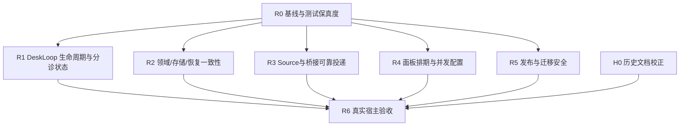

# Audit39 校正修复批次与契约

本文件是39号工程的批次计划，不是执行记录。代码、测试、构建、运行态均未修改。

## 1. 证据等级

- **E0 已复现**：Audit38 隔离探针或独立样本直接观察到错误结果；修复前必须保留最小复现。
- **E1 静态确认**：代码控制流与契约矛盾，触发条件明确；修复前要增加可运行复现。
- **E2 覆盖缺口**：测试桩/条件分支无法证明行为；先补保真度，再判断生产缺陷。
- **H 历史漂移**：文档/旧报告与当前树不一致；不改业务代码，单独校正文档。

## 2. 发现覆盖矩阵

|发现ID（Audit38）|基线证据/级别|目标批次|开工前必须补的证据|预期处置|
|---|---|---|---|---|
|F01 Desk恢复顺序（runtime-review RT01 / 汇总 RUNTIME-01）|E0，runtime prototype|R1|真实Runtime重启用例，DeskLoop构造/未配置/active三个分支|恢复先于可判定能力的问题，不能只调一行顺序；确保失败配置也不遗失Ticket|
|RT02 DeskLoop stop/join|E1，静态|R1|阻塞LLM stream+stop+SQLite闭库后的写入探针|signal贯通、queue resolve/reject策略、wait current完成后Store.close|
|RT03 timeout误drop worker|E0，prototype|R1|worker askDesk真实工具触发 timeout，确认只污染desk不终止worker|超时处role gate；triage timeout dropped；worker timeout可见且不篡改领域状态|
|RT04 provider error partial→ready|E0，prototype|R1|error/aborted/max-tokens/finish缺失的provider契约|依据finish reason拒绝把partial当success，保留可见失败文本|
|RT05 main triage brief混入worker report|E1，静态|R1|以两种模式捕获完整Prompt和工具registry；当前Runtime实际给triage额外register myagent_report，先更新旧结论|按真实main triage工具面修提示；不可误删其合法的myagent_report扩展|
|RT06 同大小物化错误当成功|E0，prototype|R2|决定哈希/字节比较成本和并发写策略|目标存在时证明内容一致，不一致明确冲突|
|RT07 AbortSignal未给provider|E0，prototype|R1|provider未响应的可取消测试与底层DSH信号契约|信号进入GenerateOptions并保证Runtime stop可达provider|
|RT08 prior replied永久挡后续结案|E0，prototype|R1|同一attempt多relay边界，reply事件与requestId关联方案|仅当前turn已追问才保留open|
|RT09 requestId重入重复LLM|E0，prototype|R1|并发重复relay与进程重启语义；明确至少一次还是一次|持久执行状态/单flight；外部工具副作用需幂等或补偿|
|RT10 Busy/未配置relay resolve但票挂起|E1，runtime静态|R1|无provider、settings从disabled启用、插件reload时队列实际持久性|定义拒绝、等待、恢复政策与端到端验收|
|CORE-01异机StateLock unlink|E0，lock prototype|R2|明确部署支持单机还是共享FS；多进程/多主机临时目录实验|异机持有者保守拒绝；不能由本机kill(pid)判死|
|CORE-02 Chat已take后fanout ended ticket中断|E1，静态|R3|ended/deleted subscription多订阅故障用例|过滤失效订阅、逐项隔离异常、主消息与context送达语义分明|
|CORE-03 Watchdog先dedupe后report|E1，静态|R2|report失败后下一次look的测试|成功后记dedupe或显式失败重试|
|CORE-04 Memory Thread事务不回滚|E0，双存储probe|R2|同一断言覆盖Thread所有写路径/嵌套savepoint|补snapshots并Memory/Store契约测试|
|CORE-05 Prompts config/revision分写|E0，Store stub；调用事务边界待核|R2|验证HTTP/Runtime调用方是否包atomic，注入第二写失败|按唯一事务所有者改写，不做重复事务/通知|
|CORE-06 Inbox readdir错误伪装空|E1，静态|R3|隔离权限/删除目录实验，判定平台可模拟性|IO失败不得record healthy/推进消息游标|
|CORE-07 Events max(seq)+1并发|E2，竞争风险|R2|两SQLite连接/不带StateLock的竞争探针|唯一seq由SQL/事务原子保证，或明确单写者硬约束与错误处理|
|CORE-08 Pass stop超时后任务未取消|E1，静态|R2|卡住extra、stop timeout、Store关闭后写入探针|取消或等待/隔离继续工作，数据库生命周期清楚|
|CORE-09 unknown effect kind永久未claim|E2|R2|注入未知kind、观察健康/移除决策|未知任务告警且不破坏数据，提供人工恢复 |
|BRIDGE-01 Telegram offset先于入站落盘|E1，静态|R3|写入失败/崩溃窗口、同update重投测试|写入成功后推进offset，文件名与消息身份幂等|
|BRIDGE-02 WeCom Crypto格式|E0，独立非官方样本失败|R3|取得可信官方测试向量；未获得前不得宣称协议修复|标准长度字段/padding/signature兼容，多版本错误分类|
|BRIDGE-03 WeCom agentId作touser|E1，静态|R3|多用户/多Agent回信映射用例|route thread与平台真实会话坐标分开|
|BRIDGE-04 WeCom未限流/先200后写|E1，静态|R3|超限chunk及write失败测试，外网隔离|有界读取、验证后接收、durable write后ACK|
|BRIDGE-05 四个push桥tick重叠|E1，静态|R3|超过interval的send延迟、退出中poll测试|单flight/claim；signal时排空当前发送|
|BRIDGE-06 QQ拒绝码视作成功|E1，静态|R3|真实/fixture 304023/304024并确认fallback/配额|区分HTTP和业务码，成功归档只在真实接受后|
|BRIDGE-07 附件文件名跨消息覆盖|E1，静态|R3|同channel两个来源上传同名/不同字节并延迟worker|路径按消息身份隔离，不可重写先前已接收附件|
|UI-01 排期丢deliverTo/budget/preset|E1，静态+panel fixture|R4|field round-trip/save/toggle/delete四路径|完整往返；保留已有未知/新字段或拒绝并发覆盖|
|UI-02 Desk分页latestSeq跳过/加载更多无handler|E1，静态|R4|>50消息、seq trim、点击Load more|游标取本页最后返回seq，分页方向与trim语义一致|
|UI-03 生成service路径未shell转义|E1，静态|R4|空格/引号/$()/换行输入，解析生成结果不执行|分别正确转义plist/systemd/shell或拒绝输入|
|UI-04 settings并发整表PUT覆盖|E1，静态|R4|两个stale revision交错提交|ETag/CAS或字段patch；冲突可见|
|UI-05 about CHANGELOG空态|已撤回|不进入修复|panel.spec反证有empty-state处理|不得把旧审核误报变成工作项|
|UI-06 desk panel响应游标/原地修改|E1候选|R4|panel实测及错误PUT复现|SR-21保留候选，不先写修复断言|
|REL-01 release目标仓身份/dirty guard|E1，静态|R5|仅临时Git仓模拟各拒绝条件，脚本不得连真源|realpath、remote、branch、dirty、源目标差异均前置拒绝|
|REL-02 commit失败仍push|E1，静态|R5|hook强制commit失败，核push未触发|空提交与commit失败分开，失败短路|
|REL-03 最终内容未重新扫描|E1，静态|R5|改version/二次add后注入敏感标记验证|扫描精确最终index/tree，冻结后push|
|REL-04 verify-migration吞错/漏验schema|E1，静态|R5|临时副本/WAL、新旧构建真实打开/回滚|任何命令错误非零；迁移前后目标schema和业务数据均断言|
|TEST-01–04 测试假桩/弱断言|E2|R0|每个桩变异让关键断言红|先增强桩及控制组，不将probe通过算feature pass|
|EX-02–07 examples历史脚本|E1/历史资产，不在运行主链|H0/另批|决定是否继续维护和发布|不阻塞核心；若继续维护则为每工具加离线fixtures/无损写|
|H-01 文档旧状态与失效证据|H|H0|现状声明逐文档列截止版本/产物|保留历史文字，新增显眼生效版本索引，不覆盖原证据|

任何E0/E1问题先补复现。证据重分类必须同步39号总控、覆盖矩阵和处理理由。

任何矩阵项没有测试/变异/回滚字段完整落盘，不能进入“可执行”状态。

## 2. 依赖拓扑



R0 必须先于所有业务修复：当前假桩会让“取消成功、idle、解绑、附件物化、HTTP坏JSON”产生假绿。R1/R2 可并行但每批独立提交；R3/R4/R5 互不共享修改文件时才并行。R6 必须在所有批次通过后执行。

## 3. 批次 R0 · 基线、保真度和审核工具（P0）

### 目标

建立不污染日常宿主的隔离profile/stateDir/端口；冻结源码与产物身份；修正测试假桩和审计探针分类；让测试失败能代表真实前置条件。

### 范围

- `tests/helpers/host.ts`：真实模拟 cancel→status、whenIdle 等待、disposer 移除、工具注册替换/解绑。
- `tests/helpers/deployment.ts`：消除固定短等待作为主要判据，统一可诊断的 until-pass。
- `tests/flow.spec.ts`：附件必须验证 inputs 真实字节物化，不允许“目录不存在则只查元数据”的降级。
- `tests/http.spec.ts`/helpers request：构造真正非JSON body、多chunk、流中断。
- `tests/desk-tools.spec.ts`：成功管理工具调用使用真实 Engine/Store（可隔离Memory+Store双实现）。
- `tests/panel.spec.ts`：修复无matcher断言；补删除后负向读取、无关归档、排期新字段。

### 契约

1. 测试桩的状态变化、取消、等待、卸载必须可观察且与生产方向一致。
2. “目录不存在时跳过”不再是有效通过路径；附件断言必须验证文件内容。
3. 审核探针标记为 defect-observation，不计入产品功能测试的“通过覆盖”。
4. 任何测试辅助改动要先跑R0最小测试，再跑完整闸门；不得在生产文件变异。

### 验收

- 取消后 agent status/whenIdle/disposer 断言变红于错误实现。
- 附件复制失败、坏JSON、工具成功调用各有红/绿对照。
- M-R0a：恢复旧弱cancel桩→取消/解绑测试变红。
- M-R0b：删除真实附件存在性断言→附件测试变红。

### 回滚

只回滚R0测试与helpers提交；不触碰Store/运行态。若保真桩导致大量既有测试红，先保留失败报告，不能放宽断言。

## 4. 批次 R1 · DeskLoop 生命周期、分诊状态与LLM失败语义（P1）

### 目标

修复启动恢复顺序、停止/取消、超时误drop、错误finish误ready、旧reply永久阻塞、重复requestId重复LLM、空配置/队列遗留票。

### 依赖

R0完成；R1涉及 `runtime.ts`、`desk-loop.ts`、`desk-llm.ts`、`executor.ts`、`sessions.ts`、相关测试，禁止与其他批次并发修改这些文件。

### 契约

1. **恢复**：recover必须在DeskLoop routing capability已可判定后处理main-desk triage；重启不丢running triage。实现可选择“先创建/初始化DeskLoop再recover”或独立持久恢复队列，但必须测试启动失败/未配置时行为。
2. **生命周期**：Runtime.stop必须取消DeskLoop provider、拒绝/排空队列并等待当前turn结束，Store.close之前不得有DeskLoop写入。
3. **角色**：只有`role: triage`且running的Assignment允许DeskLoop直接report；worker超时只能记录错误/中断自己的执行，不能report dropped。
4. **LLM失败**：finish `error`/`aborted`/`max-tokens`不能把部分文本当ready；必须可见地failed/dropped并写Ticket事件。stream必须接受AbortSignal。
5. **回合幂等**：同一requestId若已接受处理，重复relay不得再次触发LLM或工具副作用；消息历史与执行锁语义一致。
6. **答复结案**：replied判定必须限于当前relay/turn，而非整个Assignment历史；直接回答应可结案，追问应保持打开。
7. **未配置**：relay进入running triage而DeskLoop不可用时，要有明确转交/排队/失败策略，不得静默resolve永久悬挂。

### 验收与变异

- 重启时running main triage重新入队且role保持。
- stop后provider收到abort、queue promise有明确结果、Store不再写入。
- worker askDesk超时不改变worker Ticket outcome。
- provider error带partial text不ready；aborted/missing provider各有可见结果。
- duplicate requestId工具调用次数为1。
- 旧replied + 新回答能按当前turn正确结案。
- M-R1a：recover顺序退回旧逻辑→恢复测试红。
- M-R1b：去role guard→worker误drop测试红。
- M-R1c：去signal传递→阻塞stream取消测试红。
- M-R1d：error finish改ready→错误语义测试红。
- M-R1e：去request执行去重→重复副作用测试红。

### 回滚

R1任何一项不能在隔离Runtime/真实Store中稳定通过，整批不发布；回滚到R0完成提交，保留失败数据库副本和日志。

## 5. 批次 R2 · 领域、内存/SQLite与恢复一致性（P1/P2）

### 范围

- `src/app/lock.ts`：异机live lock不可自动unlink；采用保守拒绝或租约协议，需明确人工清理。
- `src/core/memory.ts`：ThreadStore纳入每层快照/restore。
- `src/sources/chat.ts`：contextSubscriptions只向live Ticket fanout，单订阅失败隔离；已take主消息不能因context失败而丢主处理结果。
- `src/sources/inbox.ts`：readdir错误显式health/失败，不伪装空目录。
- `src/app/store.ts`：Events seq并发策略，单写锁/SQL原子分配/重试。
- `src/app/watchdog.ts`：reportSilent成功后才dedupe，失败可重试且可见。
- `src/app/effects.ts`：未知effect kind写健康/永久故障记录，不无限静默留表。
- `src/app/passes.ts`：stop超时取消/等待边界，防Store关闭后异步写入。
- `src/app/prompts.ts`：config/revision原子写，先确认调用方事务边界再决定模块/Store改法。

### 契约与验收

Memory与Store同一事务断言，Thread/Project/Work/Dependencies全部纳入。跨连接/跨主机实验必须在隔离副本，不用日常stateDir。Lock异机记录不删除；未知effect可诊断；inbox IO红线可见；Watchdog故障后下一轮仍告警。

变异：移除Thread snapshot、恢复外国lock unlink、先add reportedSilence、吞inbox错误、删除unknown effect health、取消Pass stop等待→对应测试必须变红。

### 回滚

Store/schema涉及任何迁移必须单独副本演练；不得直接升级日常数据库。R2提交拆为Memory/lock/source/pump/prompts小提交，任何一个失败只回滚子批。

## 6. 批次 R3 · 桥接协议与出站可靠性（P1）

### 范围

- Telegram offset：入站成功落盘后再推进offset；重复update必须幂等。
- WeCom：按官方向量验证4字节长度、AES padding、signature；先认证/限流/限体积，durable write后ack；thread/touser用真实用户坐标。
- QQ：304023/304024视为被动拒绝并fallback；附件隔离命名。
- Lark/DingTalk/QQ/WeCom：outbound tick单飞锁、停止时等待当前tick；共享state读改写串行化。
- outbound attachments：每附件结果可见，部分失败不能整条归档为sent。
- 同名附件：消息ID/线程命名空间隔离，跨消息不能覆盖。

### 验收

所有桥纯协议测试、失败重试、崩溃窗口测试先离线；再以测试账号/隔离channel做真机验收。禁止用自循环加解密代替官方向量。每次平台调用记录脱敏request/response code，不记录凭据。

### 变异

offset先写后入站→漏消息测试红；去单飞锁→重叠tick测试红；QQ把拒绝码重新视作ok→未送达断言红；附件改回原名→跨消息覆盖红；WeCom去长度字段/autoPadding→官方向量红。

### 回滚

桥是独立进程，先停止对应桥、备份channel state目录，再替换；保留out未发送文件和state快照。失败只回滚该桥，不回滚myagent核心。

## 7. 批次 R4 · 面板、配置并发与发布安全（P1/P2）

### 范围

- panel schedules：完整保留`deliverTo/maxRuntimeMs/preset`；后端/前端使用字段级更新或revision/If-Match。
- panel desk history：游标推进按返回最后seq，明确分页方向；加载更多必须有实际handler。
- panel settings：revision冲突返回409，不覆盖并发更新。
- launchd/systemd路径转义或严格路径校验。
- release.sh：目标realpath/remote/branch/clean确认；commit失败立即退出；最终改写后重新扫描；dry-run不能覆盖工作树。
- verify-migration：停止/快照/WAL/目标schema/旧构建回滚都需硬判据，禁`|| true`吞主错误。

### 验收

jsdom断言新字段保存/启停/删除，两个并发保存至少一方409；真实生成单元经shell解析检查；发布脚本在临时仿真仓库中验证失败不push、不delete错误目标；迁移在副本执行并重新打开。

## 8. 批次 H0 · 历史文档与状态校正（P2，不阻塞业务修复）

- 建当前唯一状态页，记录version/schema/test/artifact hash和时间。
- 给历史验收文档统一加“历史产物/不可代表当前”的标记，不重写历史证据。
- 更正37号中无法由当前树支持的executor/follow-up覆盖声称、累计queued误读、无效变异等结论。
- 建文档本地链接检查与状态字段机器生成脚本；历史/tmp证据移入有版本控制的脱敏证据目录前不改变原文结论。

## 9. 发布总门槛

任何业务修复批次发布前必须同时满足：

1. 纪律账本先有计划、基线快照和文件边界。
2. R0保真度测试通过；目标批次最小测试、typecheck、全量闸门退出0。
3. 修复后对应变异注入必须让测试红；变异还原后逐字节hash一致。
4. 生成物重新构建后，源码树/随包文件/产物hash重新钉住；已有用户lib修改不得覆盖。
5. 真实宿主只读检查通过；涉及桥/平台的批次需要隔离测试账号与state快照。
6. 回滚演练有退出码和证据；未验证回滚不得推送。
7. 修复报告、测试报告、变异报告、运行态报告和提交关系一一可追溯。
8. 任意高危未解决项都阻止发布；P2可带条件发布但必须列明风险、责任人与复核日期。

## 10. 每批操作日志模板

```text
[时间 Asia/Shanghai] 批次/操作：
目标与证据等级：
前置快照（git HEAD、remote、源码/产物hash、运行态边界）：
允许修改文件：
禁止修改文件：
命令与真实退出码：
测试/变异/真机输出证据：
失败与处置：
回滚证据：
提交与推送：
下一步：
```
